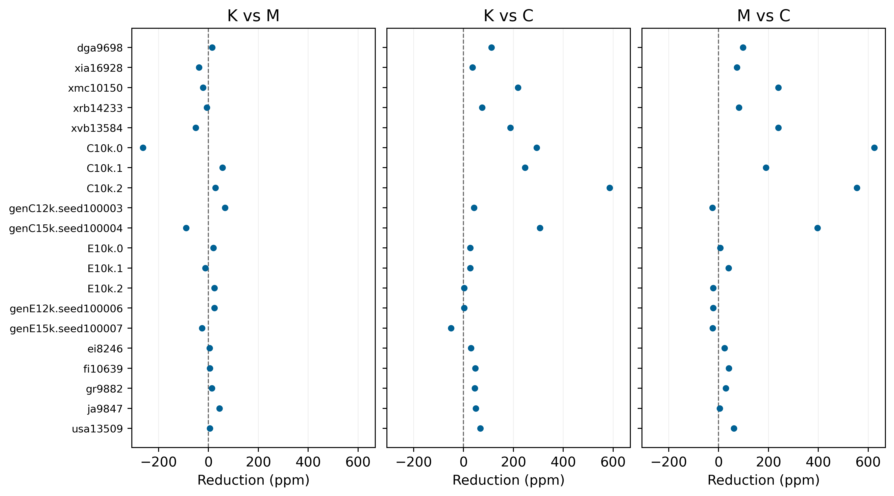
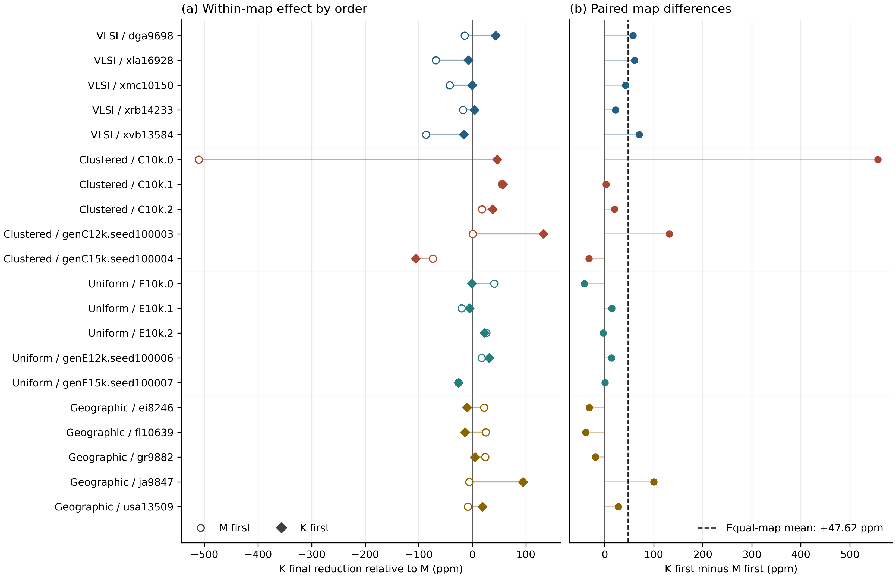

# Evaluating Additional External GPX2 Recombination in Fixed-Budget LKH Search for the Traveling Salesperson Problem

Authors and affiliations [to be confirmed]

## Abstract

We tested whether three additional pairwise generalized partition crossover (GPX2) operations shorten the final tour under a fixed total budget in the symmetric Euclidean traveling salesperson problem. The reference arm C searched directly from coordinates using a common LKH-derived configuration. M continued from the shortest of three parent tours. K selected the shortest eligible tour from the same parents and three external GPX2 outputs before continuation. M and K each paid the full cost of their shared parent pool. K also paid for its additional recombination and validation. The primary batch used 20 maps, ten seeds per map and a 90 s budget. All 600 runs reached a terminal state, and 596 delivered independently verified tours. Against M, K was shorter in 97 of 198 valid pairs, tied in 28 and longer in 73. The map-equal mean reduction was −9.98 ppm (95% map bootstrap interval [−43.47, +15.36], two-sided p = 0.648). Against C, K and M had mean reductions of +117.59 and +130.64 ppm (Holm-adjusted p = 0.000252 and 0.001682). Earlier V22 and R4 results are reported separately. The primary comparison leaves the mean benefit of the extra recombination uncertain under the tested conditions.

**Keywords:** traveling salesperson problem, Lin–Kernighan–Helsgaun, partition crossover, fixed-budget evaluation, paired experiments

## 1. Introduction

When a heuristic must deliver a complete tour by a fixed deadline, time devoted to creating and combining initial tours is time not available for later search. The Lin–Kernighan–Helsgaun (LKH) heuristic [1] and generalized partition crossover (GPX2) [2, 3] are established approaches. They can be composed in many ways, but an improvement of the intermediate tour does not itself establish an improvement of the final delivered tour. GPX2 already supports recombination among LKH results, and earlier studies have considered both crossover inside LKH and feedback of improved solutions to search [2, 3, 4].

We compare three project-defined configurations rather than propose a new crossover. C starts independently from the instance, M selects the shortest of three parent tours and continues search, and K performs three additional pairwise GPX2 operations on that same pool before continuation. Necessary generation, selection, recombination, verification and delivery are charged to the appropriate method. We ask whether the additional three-pair preparation improves final tour quality relative to M under the same total budget. The current secondary comparisons concern C. Historical baselines and start-to-finish observations are reported separately.

This study contributes a same-parent comparison in which both M and K are charged for producing their shared parents, alongside separate reporting of route quality and delivery. It measures the net effect of K’s three additional recombinations and describes when a shorter selected starting tour did not retain its advantage at the deadline. V22, R4 and the conditional old-pool diagnostic provide separate historical context. These observations apply to the recorded configurations and do not by themselves identify the cause of a reversal.

## 2. Related work

Helsgaun’s LKH implements the Lin–Kernighan heuristic [1]. LKH-2 extended k-opt submoves [5], and the LKH-3 report describes the later solver lineage [6]. Tinós, Helsgaun, and Whitley [2, Sections 4–5] compared GPX2 and IPT inside multi-trial LKH at preset trial and run counts and reported that better offspring did not necessarily improve the surrounding iterated local search. GPX2 has also been studied across separate runs [3], and Hains et al. [4] studied crossover on clustered TSP instances. Our paired contrast quantifies the net effect of three extra GPX2 calls on final delivered tours. Both methods use the same three-parent pool and pay its full cost under the same total wall-clock budget.

POPMUSIC has been used to construct LKH candidate edges using tour information [7]. Friedrich et al. [8] and Weise et al. [9] study fixed-budget bet-and-run strategies, including allocation of decision time and prediction; choosing among short initial searches is therefore not a new general strategy. Zhang and Looks [10] use backbone information from tours to guide LK search and perturbation. Our M is a concrete comparison configuration, not an invented bet-and-run framework. Recent candidate-list and partition-crossover studies [11, 12] further limit any general novelty claim. McMenemy et al. [13] already compared LKH variants and EAX across a large set of structurally varied instances and investigated instance characteristics; their setting and budgets differ from ours. The present study differs operationally by recording the exact shared parent pool, charging its cost to both arms, and testing the *net* effect of three additional external GPX2 calls on delivered tours. Different implementations, benchmarks and deadlines prevent direct numerical comparisons with the cited studies.

Algorithm benchmarking distinguishes quality at a common budget from work or time to reach a common target [14, 15, 16]. We evaluate verified quality at a common wall-clock deadline.

## 3. Problem and comparison methods

For coordinates \(p_i=(x_i,y_i)\), the edge cost is \(d(i,j)=\lfloor\sqrt{(x_i-x_j)^2+(y_i-y_j)^2}+0.5\rfloor\) under the TSPLIB EUC_2D convention [17]. A feasible solution visits each city exactly once and returns to the starting city. The tour length is the sum of all cycle edges. Independent checks verify coverage and EUC_2D length.

All three arms use the same frozen, modified LKH 3.0.14-derived Windows executable. The common configuration uses POPMUSIC candidate construction, at most five candidates per node, no subgradient ascent, MOVE_TYPE = 5, SUBSEQUENT_MOVE_TYPE = 5, MAX_TRIALS = 100000, RUNS = 1, POPULATION_SIZE = 0, SCALE = 1 and PRECISION = 100. C_ref is the configured reference used in this study. The historical P5 builds and the historical author-LKH baselines have separate version records.

- **C_ref (C)** searches directly from the coordinates with the nominal group seed \(s\) and no supplied initial tour.
- **M_new (M)** selects the shortest of three verified parent tours, then continues through a fresh invocation of the common solver with seed \(s+3000\) and the selected INITIAL_TOUR_FILE.
- **K_new (K)** uses the same three physical parent tours and performs three external GPX2 calls on P1/P2, P1/P3 and P2/P3. It verifies the children and selects the shortest eligible tour from the parents and children before the same configured continuation with seed \(s+3000\). Ties retain the first eligible candidate, with parents ordered before children.

Parents use seeds \(s\), \(s+1000\) and \(s+2000\). The shared pool is generated once per map–seed group. M and K each pay the full measured generation, certification and sealing cost of that pool. K also pays for its three external programs, candidate preparation, validation and selection. The same total budget allows different amounts of continuation time. The first actual working tour of each continuation is checked against the selected input.

RECOMBINATION = GPX2 selects a merge function in the common binary. RUNS = 1 and POPULATION_SIZE = 0 rule out the between-run and population branches. The linked trial routine can still attempt internal merges after a Lin–Kernighan improvement step if its elapsed-time and tour-state conditions permit. Trace level 1 does not enumerate those attempts. This conditional internal behavior is shared by C, parent generation and continuation. K's three pre-continuation bridge calls are explicit external operations. Supplementary Table S2 gives the configuration and its source conditions.

## 4. Experimental design and validity

### 4.1 Primary 600-slot batch

The current batch used 20 prespecified maps spanning engineering VLSI, clustered, uniform and geographic strata, with five maps per stratum. Each map used the same ten registered seeds. The main table has 200 slots per C, M and K, with M and K adjacent and each running first in five groups per map. The inputs and map-source manifest were frozen before dispatch. The two DIMACS strata use the Challenge generators and reference descriptions [18, 19], including project-generated extensions whose seeds are listed separately. The Waterloo VLSI and National collections are cited at their source [20, 21]. One geographic instance comes from TSPLIB [17]. A native Windows host executed the solvers serially on CPU0, with independent resource monitoring on CPU1. The per-process commit limit was 4 GiB. The minimum required available physical memory was 12 GiB at admission and 8 GiB during execution. The operating-system stop and monitor evidence was retained. Affinity specifies placement. Table 1 reports the recorded host and toolchain. Supplementary Table S1 identifies the evidence for each setting.

**Table 1. Recorded environment for the primary 600-run experiment.**

| Item | Recorded value |
| --- | --- |
| Host CPU | Intel Core Ultra 9 275HX, 24 cores and 24 logical processors. Same-host inventory dated 16 November 2026. |
| Physical RAM | 48 GiB installed in the host inventory. All 596 valid run receipts report 50,870,607,872 bytes (47.377 GiB) visible to Windows. |
| Operating system | Native Windows 11, build 10.0.26300, from the 20 November build receipt. |
| C compiler and target | w64devkit GCC 16.2.0, x86_64-w64-mingw32. |
| Main build flags | Common solver: `-O3 -std=gnu99 -fcommon -DTWO_LEVEL_TREE -march=native -ffp-contract=off`, forced Windows platform header, link `-lm`. The external bridge added `-ffunction-sections` and `-fdata-sections` to its two newly compiled units and linked with `-Wl,--gc-sections -lm`. |
| Logical affinity | Serial solver Job on logical CPU 0 (mask 1). Monitor on logical CPU 1. |
| Power and CPU state | All 596 valid admission receipts record AC power. Continuous supply status, active power plan, performance mode, and effective frequency during runs were not recorded. |

Each arm has a 90 s total charged window. The stop request is scheduled at 85 s. Required evidence of search termination is due strictly before 86 s, certification strictly before 88 s and cleanup strictly before 90 s. For each physical parent, the corresponding times are 17, 18, 19 and 20 s. Input handling, candidate construction, search, applicable common-pool and branch work, verification, delivery and cleanup are charged. Admission waiting is outside any dispatched method's charged clock. The independent terminal-route replay is post-experiment verification. It cannot create a scored candidate retrospectively.

The export now labels the historical field selection_s as last_external_gpx_verified_charged_s. It records a charged-clock observation at the last external child's independent verification, with the common-prefix offset included. It cannot be interpreted as a pure GPX2 or selection duration. Recorded release, certification, search-stop proof and cleanup fields are different time observations. The records do not establish when individual candidates were first found internally.

The registered EAX arm (200 slots) and separate mechanism protocol (800 slots) were deferred at admission. The analysis below covers the three admitted arms.

### 4.2 Historical batches

V22 used native Windows on the CPU2 server, 20 maps and five seeds per map, with 300 valid C/M/K outcomes. R4 used native Windows on a local laptop, 12 maps and three seeds per map. Its five core methods delivered 164 valid tours in 180 slots. Its six 10,000-city generated maps contain uniform, clustered and mixed structures. The six 1,500–2,000-city research maps came from the University of Stirling collection [13]. M ran before K in R4. The recorded time fields and two previously exposed groups are handled under its own protocol. V22, R4 and the current study differ in inputs and frozen configurations and retain separate effect estimates.

### 4.3 Statistical analysis

For left arm X and reference Y with two valid tours at the same map and seed, the length reduction is \(10^6[L(Y)-L(X)]/L(Y)\) ppm. Positive values favor X. We average paired seed effects inside each map and give each map with usable pairs equal weight. Delivery and invalid attempts are counted separately. The K/M estimate uses every eligible K/M pair regardless of C's outcome.

For the primary 600-slot study, we retain the registered K/M two-sided map sign-flip test and the 95% percentile interval from 100,000 map-level bootstrap resamples (seed 20261120). The test assumes independently exchangeable effect signs under the null [22]. Bootstrap draws resample complete maps [23]. The intervals describe sensitivity to which of the fixed maps are resampled. The four registered secondary comparisons are K/C, M/C, K/EAX and M/EAX. The two unobserved comparisons retain p = 1 placeholders solely for Holm adjustment [24]. Four-stratum summaries, leave-one-map checks and the common set of 196 complete C/M/K groups are descriptive sensitivity analyses. The historical R4 five-comparison family and its 20,000 resamples are kept separate.

## 5. Results

### 5.1 Primary C/M/K batch

All 600 scheduled C/M/K runs reached terminal status. C, M and K delivered 198, 199 and 199 valid tours respectively. All 596 were independently verified. One C run was interrupted by lack of disk space. Two runs were interrupted by the original runtime paging guard (one K and one C), and one M run was rejected by the original pre-start memory check before native search. The valid K from that M run's shared-pool group remains in the ledger and contributes wherever a legitimate comparison exists. There were no normal budget non-deliveries.

**Table 2. Primary-batch route quality among eligible matched-seed pairs.** All comparisons cover 20 maps. The interval is a percentile map bootstrap. Holm adjustment applies to the registered secondary family. The EAX contrasts were not estimated in this main batch.

| Comparison | Pairs | Shorter / tied / longer | Mean ppm | 95% interval, ppm | Reported p |
| --- | ---: | --- | ---: | --- | ---: |
| K/M | 198 | 97 / 28 / 73 | −9.98 | [−43.47, +15.36] | 0.648 |
| K/C | 197 | 105 / 6 / 86 | +117.59 | [+59.78, +186.98] | 0.000252 |
| M/C | 197 | 105 / 3 / 89 | +130.64 | [+56.19, +218.04] | 0.001682 |
| K/EAX | — | — | Not estimated | — | — |
| M/EAX | — | — | Not estimated | — | — |

The K/M map median was +5.76 ppm. Twelve map means were positive and eight were negative. C10k.0 had the most negative map mean (−263.07 ppm across nine eligible pairs). The leave-one-map K/M mean ranged from −14.02 to +3.34 ppm. The primary estimate retains all 20 maps. Table 3 and Figure 2 give the strata and per-map results. Supplementary Figure S1 gives the pair-weighted ECDF. The five equally weighted maps per stratum gave K/M descriptive means of −20.47 ppm for VLSI, −40.30 for clustered, +5.98 for uniform and +14.88 for geographic maps. These contrasts describe the selected panels. They do not identify effects of map structure independently of other characteristics. Supplementary Table S4 shows all three comparisons on the 196 groups in which C, M and K each delivered, with the original comparison-specific samples kept for the registered tests.

{width=94%}

The paid common prefix averaged 51.394 s across 200 pools. Among the 198 jointly valid M/K pairs, M and K launched their continuation solver at mean charged times of 52.803 and 53.066 s respectively. The paired launch difference of 0.262 s includes preparation, checks and system overhead. Across 200 K arms, the three external process intervals from launch to observed Job-empty state summed to 0.131 s on average per arm. These intervals include process overhead and end when exit is observed. They cannot explain the quality differences on their own.

Supplementary Table S3 and the event-accounting note separate measured phases on the charged clock. The registered three parent requests were scheduled at 17 s each. The roughly 51 s paid prefix follows from that design. Budget splits and alternative deadlines were not optimized by this experiment.

**Table 3. Descriptive map-equal effects by source stratum (ppm).**

| Stratum | Maps | K/M | K/C | M/C |
| --- | ---: | ---: | ---: | ---: |
| VLSI engineering | 5 | −20.47 | +125.80 | +146.27 |
| DIMACS clustered | 5 | −40.30 | +294.94 | +348.27 |
| DIMACS uniform | 5 | +5.98 | +1.77 | −4.21 |
| Geographic | 5 | +14.88 | +47.83 | +32.21 |

{width=94%}

### 5.2 Selected starts and delivered tours

This post hoc analysis uses the original integer lengths of all 198 valid pairs. Relative start and final differences use the corresponding M length. Gains during continuation use each arm's own starting length. Table 4 reports equally weighted seed pairs within its descriptive columns and gives the map-weighted endpoint separately. Two run groups lack a valid M/K pair, because one M failed memory admission and one K was interrupted by paging protection.

**Table 4. Starting and final tour differences (ppm).**

| Pair subset | N | Start mean / median | Final pair mean / median | Final equal-map mean | Short / tie / long | M/K continuation means |
| --- | ---: | ---: | ---: | ---: | ---: | ---: |
| All | 198 | +95.91 / +47.68 | -8.77 / +0.00 | -9.98 | 97/28/73 | 272.63/168.03 |
| K start shorter | 181 | +104.92 / +55.44 | -9.30 / +9.06 | -9.94 | 97/13/71 | 281.63/167.50 |
| Same start bytes | 17 | +0.00 / +0.00 | -3.17 / +0.00 | -2.45 | 0/15/2 | 176.76/173.59 |

K started shorter in 181/198 pairs (91.41%). It ended longer in 71/181 of those pairs (39.23%). The 17 same-file starts had 15 identical final lengths and two one-unit losses for K (xvb13584, seeds 1861 and 2521). The audit verified selected bytes and first working tours. The arms had the same continuation seed and engine within each pair. A mean 0.262 s difference in charged continuation-launch times and two one-unit differences do not identify a timing effect. The output contains no per-trial work counts or continuous frequency trace.

The three largest negative effects came from two maps (C10k.0/981 and genC15k.seed100004/2521 and /1861). They contribute −12.35, −8.14, −5.92 ppm, respectively, to the fully weighted primary estimate, with nine valid pairs on C10k.0 and ten on genC15k.seed100004. All valid scores remain in the main analysis. Supplementary Table S5 gives the disjoint time accounting and Table S6 gives the tail cases and post hoc sensitivity.

{width=94%}

### 5.3 Execution-order sensitivity

The frozen schedule assigned five M-first and five K-first groups per map using seed 20261120. The dispatch audit matched all 600 runs to their scheduled slots. Among the 198 valid M/K pairs, 99 in each order remain. The map-equal mean K/M effect was +15.47 ppm with K first and -32.15 ppm with M first. The difference was +47.62 ppm across 20 map contrasts (median +16.99 ppm, 14 positive, 95% map bootstrap interval [5.74, 111.32]). The exact two-sided map sign-flip sensitivity enumerates all 2^20 sign patterns and gives unadjusted p = 0.03557. It uses effect magnitudes and requires independently exchangeable map signs. A separate conditional within-map label-permutation sensitivity gives p ≈ 0.200 under its conditional exchangeability and no-interference assumptions [22]. Neither inference was preregistered, and the two checks address different null constructions.

Giving the two observed orders equal weight within each map gives −8.34 ppm as a post hoc K/M estimate. The registered all-valid-pair result remains −9.98 ppm. The audit records actual dispatch times, schedule epochs, the previously dispatched formal task, C position, and measured preparation and continuation. Thermal state, cache and scheduler effects, workload variation and stopping behavior cannot be separated using these observations. An execution-order association does not identify heat throttling or explain the earlier R4 result.

{width=94%}

### 5.4 Earlier exploratory cohorts

V22 and R4 used different samples, configurations and execution environments. V22 found a positive K/M mean. R4 found a small negative K/M mean and recorded some reversal of starting advantages. Its two author-LKH configurations are separate external comparators. Historical Tables H1–H9 and Figures H1–H3 in the Historical Appendix retain results, delivery failures, tests and version details, including partial historical EAX coverage [25, 26]. The 72-run earlier conditional diagnostic reused the parent pools and measured continuation alone. These cohorts are reported separately.

### 5.5 Separate follow-up batches

EAX supplement recorded 200/200 dispatched, 200 terminal and 199 valid. Conditional continuation recorded 120/120 dispatched, 120 terminal and 120 valid. These are separate series. The EAX series measures end-to-end delivery under the same time limits in a later time block. The 30 s diagnostic conditions on the distinct M and K starting tours from each of three saved parent pools on two maps, using 20 new continuation seeds per pool. No stages or scores from either series enter the registered 600-run inference. The first-attempt evidence failure at e0316 remains unscored. The original post-run audit compared a preparatory timestamp against the 85 s threshold. A separately frozen audit used the recorded owned-job termination call for unstarted slots and kept the native solver, charging, and prescribed limits unchanged. M/EAX: 198 pairs, 159/2/37 shorter/tied/longer, map-weighted mean +24030.25 ppm with 95% percentile interval [+6763.64, +50836.32]. K/EAX: 198 pairs, 164/3/31 shorter/tied/longer, map-weighted mean +24008.70 ppm with 95% percentile interval [+6742.41, +50802.43]. The separate EAX report includes delivery, missing pairs and multiplicity. The separate diagnostic gave the following pool-specific results. C10k.0/981: 14/0/6 shorter/tied/longer in 20 valid seed pairs, mean +716.29 ppm and conditional seed bootstrap interval [+251.78, +1200.80] ppm. genC15k.seed100004/2521: 12/0/8 shorter/tied/longer in 20 valid seed pairs, mean -109.03 ppm and conditional seed bootstrap interval [-371.59, +139.14] ppm. genC15k.seed100004/1861: 8/0/12 shorter/tied/longer in 20 valid seed pairs, mean -219.79 ppm and conditional seed bootstrap interval [-664.72, +273.42] ppm.

## 6. Discussion

The same-parent comparison asks what the three additional external GPX2 calls return on the full charged clock. K shortened more paired tours than it lengthened in the current batch. The larger negative effects on a few maps brought the equal-map mean below zero. Its interval spans gains and losses. The primary evidence does not establish a stable incremental advantage. Equivalence was not tested against a prespecified margin. Both M and K shortened tours on average relative to the configured C reference in the valid paired sample under the registered Holm analysis. The direct K/M contrast governs any comparison between the two shared-pool arms.

V22 had a positive K/M estimate, while R4 and the current batch had slightly negative estimates. The data sets, software and execution sequences differ. The comparison across batches cannot isolate the influence of any one factor. The recorded R4 changes between the selected starting tour and the final tour illustrate the behavior described by earlier GPX2 studies. They provide separate descriptive evidence. In the current batch, most selected K starts improved on M, but continuation sometimes reversed that advantage. The measured phase timings show how much work was charged. The order association, a matched timing audit, and extreme endpoint differences leave contributions from preparation, initial tour structure and subsequent search dynamics unresolved.

## 7. Limitations and future work

The current estimates describe 20 fixed maps, one total budget and the tested common LKH configuration. The map-level test relies on its sign-exchangeability assumption and does not turn the fixed panel into a random sample of all Euclidean TSP instances. Incomplete pairs remain missing in the conditional quality analysis. The common-coverage check uses the same 196 groups for three contrasts and is descriptive. The audit covers the test settings, tour feasibility and the software versions used. Global optimality and the number of in-process GPX2 calls remain outside the recorded evidence.

The current experiment contains no timed EAX comparison. R4 offers separate comparisons with two author LKH configurations and incomplete EAX observations. The current design evaluates the overall effect of the branch policy. The designated equal-continuation diagnostic conditions on already selected tours. It tests repetition across continuation seeds in three groups from two maps. It does not vary the total budget or the cost of producing those starts.

## 8. Conclusion

Under the current 90 s conditions, the extra external GPX2 stage produced no clear average tour-quality advantage over continuation from the shortest parent. M and K had shorter average tours than the configured C reference on their valid paired samples. Earlier V22 and R4 outcomes remain separate. Reporting map-level effects, charged preparation, delivery and invalid attempts makes the observed trade-off visible.

## Reproducibility and declarations

The author-review artifact contains the current numeric ledger, input and version manifests, a separately runnable CSV statistics and plotting workflow, and route-hash and length verification material. Existing tours can be checked against the exact coordinate bytes and authorized city-order files. The author-access appendix identifies the public sources, the items requiring authorized transfer, and the materials needed for a timed native Windows rerun. Access and redistribution are subject to the recorded terms. The release link for the previously analyzed batches is the [historical review repository](https://github.com/wang-d-c/TSP-SCI-Reproducibility-And-Evidence-20261118). Those public numerical records and historical route checks pertain to V22 and R4.

Authors, affiliations, corresponding author contact, final approval, funding and competing interests are to be confirmed by the authors before submission.

## AI assistance

ChatGPT and Codex assisted research design, code development, analysis and manuscript preparation. The authors will confirm the scope, placement and wording of the disclosure against the selected journal policy before submission and will take responsibility for the submitted text and evidence.

## References

1. Helsgaun, K. (2000). An effective implementation of the Lin–Kernighan traveling salesman heuristic. *European Journal of Operational Research*, 126(1), 106–130. https://doi.org/10.1016/S0377-2217(99)00284-2
2. Tinós, R., Helsgaun, K., & Whitley, D. (2018). Efficient recombination in the Lin–Kernighan–Helsgaun traveling salesman heuristic. *Parallel Problem Solving from Nature*, LNCS 11101, 95–107. https://doi.org/10.1007/978-3-319-99253-2_8
3. Tinós, R., Whitley, D., & Ochoa, G. (2020; online 2019). A new generalized partition crossover for the traveling salesman problem: Tunneling between local optima. *Evolutionary Computation*, 28(2), 255–288. https://doi.org/10.1162/evco_a_00254
4. Hains, D., Whitley, D., & Howe, A. (2012). Improving Lin–Kernighan–Helsgaun with crossover on clustered instances of the TSP. *PPSN XII*, 388–397. https://doi.org/10.1007/978-3-642-32964-7_39
5. Helsgaun, K. (2009). General k-opt submoves for the Lin–Kernighan TSP heuristic. *Mathematical Programming Computation*, 1, 119–163. https://doi.org/10.1007/s12532-009-0004-6
6. Helsgaun, K. (2017). An extension of the Lin–Kernighan–Helsgaun TSP solver for constrained traveling salesman and vehicle routing problems. Technical report, Roskilde University. https://forskning.ruc.dk/da/publications/an-extension-of-the-lin-kernighan-helsgaun-tsp-solver-for-constra/
7. Taillard, É. D., & Helsgaun, K. (2019). POPMUSIC for the travelling salesman problem. *European Journal of Operational Research*, 272(2), 420–429. https://doi.org/10.1016/j.ejor.2018.06.039
8. Friedrich, T., Kötzing, T., & Wagner, M. (2017). A generic bet-and-run strategy for speeding up stochastic local search. *AAAI Conference on Artificial Intelligence*, 31, 801–807. https://doi.org/10.1609/aaai.v31i1.10645
9. Weise, T., Wu, Z., & Wagner, M. (2019). An improved generic bet-and-run strategy with performance prediction for stochastic local search. *AAAI Conference on Artificial Intelligence*, 33, 2395–2402. https://doi.org/10.1609/aaai.v33i01.33012395
10. Zhang, W., & Looks, M. (2005). A novel local search algorithm for the traveling salesman problem that exploits backbones. *IJCAI*, 343–349. https://ijcai.org/proceedings/2005/182
11. Heins, J., Schäpermeier, L., Kerschke, P., & Whitley, D. (2024). Dancing to the state of the art? How candidate lists influence LKH for solving the traveling salesperson problem. *PPSN XVIII*, LNCS 15148, 100–115. https://doi.org/10.1007/978-3-031-70055-2_7
12. de Carvalho, O. Q., & Whitley, D. (2025). Dramatically faster partition crossover for the traveling salesman problem. *GECCO ’25*, 818–826. https://doi.org/10.1145/3712256.3726465
13. McMenemy, P., Veerapen, N., Adair, J., & Ochoa, G. (2019). Rigorous performance analysis of state-of-the-art TSP heuristic solvers. *EvoCOP*, LNCS 11452, 99–114. https://doi.org/10.1007/978-3-030-16711-0_7. Associated dataset record: https://datastorre.stir.ac.uk/handle/11667/127 (CC BY 4.0 for the 14 included instance files).
14. Applegate, D. L., Bixby, R. E., Chvátal, V., & Cook, W. J. (2006). *The Traveling Salesman Problem: A Computational Study*. Princeton University Press. https://www.math.uwaterloo.ca/tsp/book/index.html
15. Bartz-Beielstein, T., Doerr, C., van den Berg, D., et al. (2020). *Benchmarking in optimization: Best practice and open issues*. arXiv:2007.03488. https://arxiv.org/abs/2007.03488
16. Hansen, N., Auger, A., Brockhoff, D., Tušar, D., & Tušar, T. (2016). *COCO: Performance assessment*. arXiv:1605.03560. https://arxiv.org/abs/1605.03560
17. Reinelt, G. (1991). TSPLIB—A traveling salesman problem library. *ORSA Journal on Computing*, 3(4), 376–384. https://doi.org/10.1287/ijoc.3.4.376
18. Johnson, D. S., & McGeoch, L. A. (2002). Experimental analysis of heuristics for the STSP. In G. Gutin & A. P. Punnen (Eds.), *The Traveling Salesman Problem and Its Variations* (pp. 369–443). Kluwer. Springer digital record, 2007. https://doi.org/10.1007/0-306-48213-4_9
19. DIMACS. (2001). *8th DIMACS Implementation Challenge: The Traveling Salesman Problem*. Instance and generator archive. https://archive.dimacs.rutgers.edu/Challenges/TSP/download.html
20. University of Waterloo. *VLSI Data Sets*. Solving TSPs benchmark archive. https://math.uwaterloo.ca/tsp/vlsi/index.html
21. University of Waterloo. *National Traveling Salesman Problems*. Solving TSPs benchmark archive. https://www.math.uwaterloo.ca/tsp/world/countries.html
22. Hemerik, J., & Goeman, J. (2018). Exact testing with random permutations. *TEST*, 27, 811–825. https://doi.org/10.1007/s11749-017-0571-1
23. Efron, B., & Tibshirani, R. J. (1993). *An Introduction to the Bootstrap*. Chapman & Hall. https://doi.org/10.1201/9780429246593
24. Holm, S. (1979). A simple sequentially rejective multiple test procedure. *Scandinavian Journal of Statistics*, 6(2), 65–70. https://www.jstor.org/stable/4615733
25. Kerschke, P., Kotthoff, L., Bossek, J., Hoos, H. H., & Trautmann, H. (2018). Leveraging TSP solver complementarity through machine learning. *Evolutionary Computation*, 26(4), 597–620. https://doi.org/10.1162/evco_a_00215
26. Nagata, Y., & Kobayashi, S. (2013). A powerful genetic algorithm using edge assembly crossover for the traveling salesman problem. *INFORMS Journal on Computing*, 25(2), 346–363. https://doi.org/10.1287/ijoc.1120.0506
