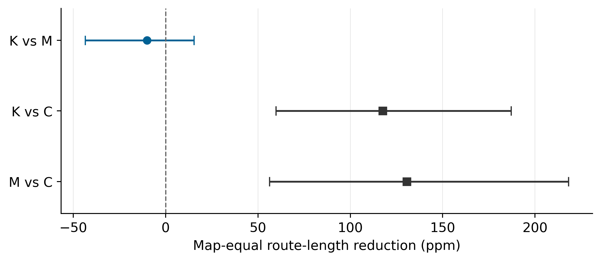

# 固定总预算下额外 GPX2 重组的配对比较

作者与单位待确认

## 摘要

本文检验固定总时间预算下，额外三次两两广义分区交叉（GPX2）能否缩短对称欧氏旅行商问题的最终交付路线。基准 C 以共同的 LKH 派生配置从坐标开始搜索。M 由三条父环中最短者续搜。K 在同一父池上执行三次外部 GPX2，从合格父环及子环中择优续搜。两臂分别全额承担共同父池费用，K 额外承担重组与核验开销。当前主批次覆盖 20 张图，每图 10 个种子，单项总预算 90 秒。600 项均取得终态，596 条路线通过独立验环计长。K 对 M 的 198 个有效配对中，97 短、28 平、73 长。地图等权平均缩短为 −9.98 ppm，95% 地图重抽样区间为 [−43.47, +15.36] ppm，双侧 p = 0.648。K 对 C 与 M 对 C 的等权平均缩短分别为 +117.59 和 +130.64 ppm，原定 Holm 校正 p 值分别为 0.000252 和 0.001682。V22 与 R4 分批报告。当前证据尚不能确定额外重组在所测条件下具有稳定的平均净收益。

**关键词** 旅行商问题，Lin–Kernighan–Helsgaun，分区交叉，固定预算，配对比较

## 1. 引言

对称旅行商问题要求给定城市各访问一次并回到起点，最小化完整环长度。LKH 使用候选集与可变深度交换搜索，在大规模 TSP 上具有影响力 [1]。增加初始路线或重组操作可能改善启发式的起点，但也会占用后续搜索和交付时间。因此，仅比较重组后的中间解，不能说明其在固定总预算下的实际价值。

当前主批次有一个登记的主要问题。在相同父池和总预算下，额外三对外部 GPX2 相对最短父环续搜是否带来最终路线净收益？20 图、600 项是主要证据，C_ref 提供共同配置下的基准。V22、R4 及历史条件诊断用于解释背景，按各自协议单列。

本文的工作是记录实际共享的父池和两臂独立计费，按图比较有效交付，同时保留未交付与资源失效。历史起点和终点记录量化了不同路线起点优势在续搜中的保留与反转。

## 2. 相关工作

Helsgaun 的 LKH 将候选边与交换搜索结合 [1]。LKH-2 扩展了 k-opt 子动作 [2]，LKH-3 技术报告描述了后续求解器 [3]。Tinós、Helsgaun 和 Whitley [4，第 4–5 节] 在预设试探次数和运行次数的多试探 LKH 中比较 GPX2 与 IPT，并指出较好的重组后代不一定改善迭代局部搜索的最终表现。随后也有跨独立运行的 GPX2 研究 [5]，Hains 等讨论了聚簇实例上的交叉 [6]。本文以相同三父路线和同一总墙钟预算为条件，两臂分别全额计入父池费用，量化额外三次 GPX2 对最终交付路线的净差异。

固定预算下以多个短运行选择后续对象，与 bet-and-run 思路有直接联系。Friedrich 等提出通用 bet-and-run 策略并包含旅行商局部搜索案例 [7]；Weise 等研究使用性能轨迹预测后续运行，并将决策成本纳入时间预算 [8]。本文 M 是针对本研究共同 LKH 配置和三个父环的一种实证比较策略。其基本思路与已有 bet-and-run 工作相关。Zhang 与 Looks 已利用多条局部最优路线的 backbone 信息偏置 LK 搜索和扰动 [9]，Taillard 与 Helsgaun 将 POPMUSIC 和路线信息用于 LKH 候选生成 [10]。因此，对基于父环的信息反馈或候选访问次序的一般原创性表述应有所限定。

已有研究比较了不同结构实例上的多种 TSP 启发式，包括使用边组装交叉的 EAX [11,12]。后续 GPX3 文献讨论了分区交叉实现 [13]。

## 3. 问题、方法及开销

对于二维坐标 \(p_i=(x_i,y_i)\)，EUC_2D 边长为 \(d(i,j)=\lfloor\sqrt{(x_i-x_j)^2+(y_i-y_j)^2}+0.5\rfloor\)，沿用 TSPLIB 定义 [15]。完整路线遍历全部城市各一次并回到起点，长度为环上各边之和。独立核验检查城市覆盖和计长。

当前三臂共用同一个冻结的 Windows 求解程序，基于原作者发布的 LKH 3.0.14 修改。共同参数包括 POPMUSIC、每节点至多五条候选边、关闭次梯度上升，MOVE_TYPE 和 SUBSEQUENT_MOVE_TYPE 均为 5，MAX_TRIALS = 100000，RUNS = 1，POPULATION_SIZE = 0，SCALE = 1，PRECISION = 100。C_ref 是本研究在该配置下的对照。旧版 P5 及旧批次作者 LKH 各有独立版本记录。

- **C_ref（C）** 以组种子 \(s\) 从坐标开始连续搜索，未指定起始环。
- **M_new（M）** 从核验通过的三条父环中选择最短者，经 INITIAL_TOUR_FILE 载入同一冻结求解器，以 \(s+3000\) 续搜。
- **K_new（K）** 对同一父池的 P1/P2、P1/P3、P2/P3 做三次外部 GPX2，独立核验子环，再从合格父环与子环中择优，以 \(s+3000\) 续搜。同长时保留候选顺序中的第一条，父环排在子环之前。

三父种子为 \(s\)、\(s+1000\) 和 \(s+2000\)。每个图与种子只实际生成一次父池，M 和 K 均计入其完整的生成、认证与封存费用。K 同时承担外部重组、准备、核验和选优费用。总预算相同，两臂可用于续搜的时间可以不同。实际首工作环与传入起始环进行核对。

RECOMBINATION = GPX2 在共同二进制中选择内部合并函数。RUNS = 1 与 POPULATION_SIZE = 0 使跨轮次合并及种群路径不生效，但试探函数在局部搜索步骤后可按时限和路线状态条件尝试内部合并。Trace level 1 未逐次记录这些调用。C、父环生成和续搜都使用这一内部配置，K 的三次外部桥接发生在续搜之前。具体参数、条件和源码位置见方法补充。

## 4. 实验材料与设计

### 4.1 当前 600 项主批次

主批次的 20 图覆盖 VLSI、聚簇、均匀和地理四层，每层五图。各图采用同一组 10 个预登记种子，共形成 200 个图与种子组合。C、M、K 各 200 项。M/K 相邻运行，每图各有五组先运行 M 或 K。Windows 原生环境下单核串行，求解绑 CPU0，CPU1 独立监控。每进程提交内存上限 4 GiB，准入时可用物理内存至少 12 GiB，运行期下限 8 GiB。EAX 200 项与机制诊断 800 项保留原计划并暂缓，未进入当前质量分析。

**表 1　600 项主批次的实验环境。**

| 项目 | 记录值 |
| --- | --- |
| 处理器 | Intel Core Ultra 9 275HX，24 核、24 个逻辑处理器，取自 2026 年 11 月 16 日同机清单。 |
| 物理内存 | 清单记录安装 48 GiB。596 份有效回执均记录 Windows 可见 50,870,607,872 字节，即 47.377 GiB。 |
| 操作系统 | 原生 Windows 11，构建 10.0.26300，取自 11 月 20 日构建回执。 |
| 编译器和目标 | w64devkit GCC 16.2.0，x86_64-w64-mingw32。 |
| 主要编译和链接选项 | 共同求解器采用 `-O3 -std=gnu99 -fcommon -DTWO_LEVEL_TREE -march=native -ffp-contract=off`，强制包含 Windows 平台约束头，链接 `-lm`。外部桥的两个重编单元增加 `-ffunction-sections` 和 `-fdata-sections`，链接使用 `-Wl,--gc-sections -lm`。 |
| 逻辑处理器亲和性 | 求解 Job 单路串行，绑定逻辑 CPU 0，掩码为 1。监控使用逻辑 CPU 1。 |
| 供电和运行状态 | 596 份有效回执都记录准入时 AC 接电。运行期间持续供电状态、电源计划、性能模式和实际频率均未记录。 |

每臂总计费窗口 90 秒，85 秒安排停搜请求，86 秒前取得停搜证据，88 秒前认证交付，90 秒前完成清理。每条父环的相应时点为 17、18、19、20 秒。输入、候选、父池、分支处理、求解、核验交付及清理均按相应方法实际计费。正式派发前的准入等待单列。实验结束后的独立验环只用于核对已交付证据。

原导出 selection_s 记录的是最后一个外部子环核验完成的累计计费时刻，包含共同前段，派生字段改名为 last_external_gpx_verified_charged_s。它不能作为 GPX2 算子净时长或单独的选优成本。提交、停止、清理与候选发现属于不同时间事件，原记录未观察到的内部发现时间保持缺失。

### 4.2 V22 与 R4 历史批次

V22 在原生 Windows CPU2 上运行，覆盖 20 图、每图 5 个种子，得到 300 项有效 C/M/K 结果。R4 在原生 Windows 本机上覆盖 12 图、每图 3 个种子，五种方法共 180 项，164 条有效路线。其六张万城合成图含均匀、聚簇和混合各两张，另六张小图来自 Stirling 数据集 [14]。R4 同池内 M 固定先运行，暴露组和计时字段按自己的协议分析。V22 与 R4 的实验版本、机器或样本有别，统计单列。

### 4.3 30 秒历史条件诊断

旧开发图的 72 项条件诊断使用 6 张已暴露地图，每图两个父池，每池三个续搜种子，对两个既有起点各运行一次。诊断窗口包含续搜输入读取与交付，父池已提前生成并免费复用。该诊断只提供历史机制背景。

## 5. 分析方法

对同图同种子、双方均有合法交付的前者 A 与对照 B，定义改善为 \(10^6[L(B)-L(A)]/L(B)\) ppm，正值表示 A 更短。先平均图内配对，再对有配对的地图等权。交付率、资源异常和执行错误单列，缺失路线不赋分。

主批次唯一主要比较为 K/M，沿用图级双侧符号翻转检验和 100,000 次地图百分位重抽样区间，随机种子 20261120。检验假定零假设下地图级效应符号可独立翻转。固定选图限制了外推。原四项次要 Holm 家族保留 K/C、M/C、K/EAX、M/EAX 两个已观察和两个未观察比较。后两项以 1 占位参与校正，并无路线结果。四层地图、留一图和 196 组三法均有效的共同配对仅用于描述性敏感性分析。R4 的五项比较族、20,000 次重抽样和 V22 的协议仍单列。

## 6. 结果

### 6.1 当前 600 项主批次

C、M、K 分别交付 198、199、199 条有效路线，596 条路线全部独立验环计长。四项异常分别为 C 的磁盘中断，K 和 C 的运行中分页保护，以及 M 在原生求解前触发启动内存门槛。同组 K 的有效结果保留，在有合法配对的比较中正常计入。预算正常耗尽且未交付的项目为零。

**表 2　当前有效配对主结果。** 三项均覆盖 20 张地图。区间为图级百分位重抽样，次要比较报告原 Holm 家族的校正 p 值。

| 前者/对照 | 有效配对 | 短 / 平 / 长 | 地图等权改善（ppm） | 95% 区间（ppm） | p 值 |
| --- | ---: | --- | ---: | --- | ---: |
| K/M | 198 | 97 / 28 / 73 | −9.98 | [−43.47, +15.36] | 0.648 |
| K/C | 197 | 105 / 6 / 86 | +117.59 | [+59.78, +186.98] | 0.000252 |
| M/C | 197 | 105 / 3 / 89 | +130.64 | [+56.19, +218.04] | 0.001682 |

{width=94%}

K/M 的地图中位效应为 +5.76 ppm，12 图为正、8 图为负。C10k.0 在九个可用配对中的地图平均为 −263.07 ppm，是最负的一图。留一图的总体均值为 −14.02 至 +3.34 ppm，主结果保留全部 20 图。描述性分层的 K/M 均值为 VLSI −20.47、聚簇 −40.30、均匀 +5.98、地理 +14.88 ppm，每层五图。该分层不能单独识别由结构造成的差异。三种方法都有效的 196 个组合另列在补充材料，原主分析继续使用各比较的有效配对。

200 个父池的共同计费均值为 51.394 秒。198 个 M/K 均有效的配对中，M 和 K 启动续搜进程的平均累计时点分别为 52.803 和 53.066 秒，配对差为 0.262 秒，其中含实际分支准备、核验和系统开销。200 个 K 臂的三个外部进程从启动到观测 Job 成员全部退出的区间，每臂合计平均 0.131 秒。该记录包含进程开销，单凭它无法解释路线质量差异。

### 6.2 V22 历史批次

100 组 K 对 C 为 36 短、38 平、26 长，K 对 M 为 44 短、41 平、15 长，M 对 C 为 27 短、37 平、36 长。20 图等权平均缩短分别为 34.76 ppm、29.30 ppm、5.46 ppm。按地图类型分层、以地图为重抽样单位的 K/C 和 K/M 95% bootstrap 区间分别为 [12.52 ppm,58.31 ppm] 和 [16.49 ppm,41.84 ppm]；对应原批主要比较 Holm 校正 p 值约为 0.01709、0.01270。这些结果仅代表 V22 的既定地图和机器条件，不与当前 600 项合并，也不作为其额外重复观测。

64 组中 K 的重组起点严格短于最好父环，其中最终 K 对 M 为 44 短、5 平、15 长；36 组起点无改善且终点平。15 个起点改善后的负例说明中间收益不保证保留，不能据此单独识别由时间差、搜索轨迹还是环结构导致。平均三对 GPX2 墙钟约 0.346 秒，其费用不能视作所有分支差异的唯一来源。

### 6.3 R4 历史配对与不确定性

**历史表 H1　R4 的 C/M/K 配对。**

| 前者/对照 | 配对/地图 | 短/平/长 | 地图等权均值（ppm） | 探索性 95% 区间（ppm） |
| --- | --- | --- | --- | --- |
| K/M | 36 / 12 | 9 / 21 / 6 | −4.05 | [−22.41, 10.96] |
| K/C | 36 / 12 | 13 / 16 / 7 | 33.27 | [7.45, 64.61] |
| M/C | 36 / 12 | 11 / 17 / 8 | 37.32 | [−0.18, 84.60] |

保留预登记的五个 Holm 比较。四个可检验对照各有六至七张非零图，可达到的最小双侧符号翻转 p 值分别为 0.03125 或 0.015625，均高于 Holm 首项 0.01。在这批实际平局格局下，该家族无法在 0.05 水平拒绝。主文据效应大小、区间和交付情况解读结果。M/C 从自身配对直接计算。

K/M 按登记指标为 2 图正、6 图平、4 图负，地图中位数为零。最大单组改善为 82.49 ppm，最差退步为 285.75 ppm（R10000-01/541，139 个长度单位）；留一图后的均值范围为 −8.87 ppm 至 3.37 ppm。六张 1,500–2,000 城公开图的 18 个配对中，两法均达到与对应实例匹配的已发表最优长度 [16]。六张万城图共有 9 短、3 平、6 长，探索性图均值为 −8.10 ppm。规模和图源、结构共变。C10000-02 的三次整数长度差相抵，登记的逐种子相对差仍有极小负量；随附辅助分析另列先求地图级方法均值再取比的结果。

英文历史附录图 H1 保留逐图相对差、精确持平和极小负差，虚线为地图等权均值。该附录表 H2 列出所有地图数值。

### 6.4 R4 历史外部基线与交付

仅在双方交付有效路线时计算质量差异。LKH-GPX2 和 LKH-POP 分别有 29/10 与 27/10 的种子/地图配对。历史交付状态表 H3 保留在英文主稿。

**历史表 H4　R4 作者配置的有效交付配对。**

| 前者/对照 | 配对/地图 | 短/平/长 | 地图等权均值（ppm） | 探索性 95% 区间（ppm） |
| --- | --- | --- | --- | --- |
| K/LKH-GPX2 | 29 / 10 | 17 / 10 / 2 | 242.25 | [65.63, 516.40] |
| K/LKH-POP | 27 / 10 | 13 / 14 / 0 | 316.30 | [76.88, 639.88] |
| M/LKH-GPX2 | 29 / 10 | 17 / 10 / 2 | 247.80 | [64.60, 538.95] |
| M/LKH-POP | 27 / 10 | 13 / 14 / 0 | 312.13 | [75.81, 632.85] |
| C/LKH-GPX2 | 29 / 10 | 16 / 8 / 5 | 204.21 | [42.25, 450.16] |
| C/LKH-POP | 27 / 10 | 13 / 12 / 2 | 259.30 | [68.96, 509.60] |

C、M、K 各交付 36 条有效路线。LKH-GPX2 交付 29 条，7 项预算内未交付。LKH-POP 交付 27 条，8 项预算内未交付，另有 1 项因资源监测中断。两种作者配置在两张聚簇万城图上各有 6 项未按期交付。登记的作者配置使用 ALPHA 候选和次梯度预处理，项目 P5 使用 POPMUSIC 候选并关闭次梯度。本研究报告这些配置在同一截止规则下的结果。

对原R4版本的18个已独立验环计长的万城有效配对，M/EAX为18短0平0长，C/EAX为16短0平2长，K/EAX为17短0平1长。该EAX是含Windows数值、输入兼容修订和预登记冷重启包装的作者Normal派生实现，不能称未经修改的原版。上述六张合成图是批次中先完成的部分，属于不完整的探索性背景，不是12图的预登记主要检验；RUE-1500失败时的高频候选处理积压也限制将该子集外推到其他实例。逐对记录、路线哈希与来源由作者留存，获取需经许可。两版 EAX 的覆盖与交付状态见[公开实验报告](https://github.com/wang-d-c/TSP-SCI-Reproducibility-And-Evidence-20261118/blob/main/%E5%AE%9E%E9%AA%8C%E6%8A%A5%E5%91%8A_%E5%85%AC%E5%BC%80%E7%89%88.md)。

### 6.5 历史起点与终点

R4 的 36 组中，M/K 起点有 16 组在旋转或反向后是同一无向环，最终长度均相同。另外 20 组 K 起点较短，最终 9 短、5 平、6 长，见英文历史附录图 H2。三对 GPX2 的平均墙钟耗时为 0.33 秒。M 和 K 记录的平均续搜预算为 31.15 秒和 30.88 秒，预算差包含分支准备与核验。不同方法记录的计时时刻含义不同。R4 的 final_delivery_s 对 M/K 表示含共同前段的最终计费提交，对 C 和两种作者 LKH 配置表示所选计分候选提交。后者可能早于观测到的停搜。该字段无法比较不同方法的发现或停搜速度，内部发现时刻可能未知。 英文历史附录图 H3 展示 36 个地图内种子配对终点差。

旧开发 72 项条件诊断中，A 是最短父环，B 是历史 K 选定的环。B 的终点为 12 短、20 平、4 长，六图等权平均缩短 16.77 ppm。18 个同环对全部持平；18 个不同环对的 B 起点都更短，终点为 12 短、2 平、4 长。A 固定先运行，复用父池且该诊断仅计 30 秒续搜费用。R4 的单池只用一个续搜种子。

## 7. 讨论

当前 K 对 M 的短例多于长例，但少数图的负差幅度较大，使地图等权点估计略偏向 M。区间跨零，额外三次外部重组带来的平均净收益仍不确定。相对共同配置的 C，K 与 M 在各自有效配对中均有较短的地图等权平均路线，两项次要比较经原 Holm 校正后仍获得支持。两臂之间的结论来自直接的 K/M 配对。

V22 的 K/M 平均值为正，R4 与当前点估计略负。图集、执行器、预算核对与软硬件条件各有差异，跨批方向不能归因于单个因素。R4 记录的起点和终点差异与既有 GPX2 研究提出的问题一致，提供历史描述性证据。本批的共同前段与分支费用据实记录。费用与终点差异的相关性无法分离重组准备、候选构造、起始环结构与后续轨迹的作用。

## 8. 结论

在登记的 90 秒、20 图及统一 LKH 配置下，额外三对外部 GPX2 相对同父池 M 的平均路线收益尚不确定。K 和 M 相对 C 的有效配对平均路线均缩短。记录完整计费、交付和失败，能区分两臂的路线影响与运行可用性。

本批未运行 EAX。R4 的两种作者 LKH 及部分 EAX 只提供分列的历史对照。最大图 EAX 工程候选缺少截止前停止的完整证明，未进入计分。地图为固定样本，运行顺序、算法配置及时间窗均限制解释，结论也不等同于全局最优或方法等效。

## 数据、软件和声明

随包提供当前数字账本、参数与版本索引、CSV 独立复算和绘图入口、路线哈希及计长核验资料。复核既有路线需要取得匹配坐标与经授权的城市顺序文件。从坐标重新定时求解还需要依法取得冻结求解器、衍生修改和符合原资源规则的 Windows 环境。审稿访问和取得条件见证据附录。V22、R4 的原始数字和历史复算仍可从[历史仓库](https://github.com/wang-d-c/TSP-SCI-Reproducibility-And-Evidence-20261118)查询。

作者、单位、通讯方式、基金、利益冲突和终稿同意待作者核实。

## AI 辅助声明

ChatGPT 和 Codex 辅助了研究设计、代码开发、分析和稿件准备。作者投稿前按目标期刊要求确认披露范围、位置与措辞，并对提交内容和证据负责。

## 参考文献

1. Helsgaun K. An effective implementation of the Lin–Kernighan traveling salesman heuristic. *European Journal of Operational Research*. 2000;126(1):106–130. https://doi.org/10.1016/S0377-2217(99)00284-2
2. Helsgaun K. General k-opt submoves for the Lin–Kernighan TSP heuristic. *Mathematical Programming Computation*. 2009;1:119–163. https://doi.org/10.1007/s12532-009-0004-6
3. Helsgaun K. An extension of the Lin–Kernighan–Helsgaun TSP solver for constrained traveling salesman and vehicle routing problems. Technical report. Roskilde University; 2017. https://forskning.ruc.dk/da/publications/an-extension-of-the-lin-kernighan-helsgaun-tsp-solver-for-constra/
4. Tinós R, Helsgaun K, Whitley D. Efficient Recombination in the Lin–Kernighan–Helsgaun Traveling Salesman Heuristic. *PPSN*, 2018:95–107. https://doi.org/10.1007/978-3-319-99253-2_8
5. Tinós R, Whitley D, Ochoa G. A New Generalized Partition Crossover for the Traveling Salesman Problem: Tunneling Between Local Optima. *Evolutionary Computation*. 2020;28(2):255–288. https://doi.org/10.1162/evco_a_00254
6. Hains D, Whitley D, Howe A. Improving Lin-Kernighan-Helsgaun with Crossover on Clustered Instances of the TSP. *PPSN*, 2012:388–397. https://doi.org/10.1007/978-3-642-32964-7_39
7. Friedrich T, Kötzing T, Wagner M. A Generic Bet-and-Run Strategy for Speeding Up Stochastic Local Search. *AAAI*, 2017. https://doi.org/10.1609/aaai.v31i1.10645
8. Weise T, Wu Z, Wagner M. An Improved Generic Bet-and-Run Strategy with Performance Prediction for Stochastic Local Search. *AAAI*, 2019. https://doi.org/10.1609/aaai.v33i01.33012395
9. Zhang W, Looks M. A Novel Local Search Algorithm for the Traveling Salesman Problem that Exploits Backbones. *IJCAI*, 2005:343–349. https://ijcai.org/proceedings/2005/182
10. Taillard É, Helsgaun K. POPMUSIC for the Travelling Salesman Problem. *European Journal of Operational Research*. 2019. https://doi.org/10.1016/j.ejor.2018.06.039
11. McMenemy P, Veerapen N, Adair J, Ochoa G. Rigorous Performance Analysis of State-of-the-Art TSP Heuristic Solvers. *EvoCOP*, 2019, LNCS 11452:99–114. https://doi.org/10.1007/978-3-030-16711-0_7
12. Nagata Y, Kobayashi S. A Powerful Genetic Algorithm Using Edge Assembly Crossover for the Traveling Salesman Problem. *INFORMS Journal on Computing*, 2013, 25(2):346–363. https://doi.org/10.1287/ijoc.1120.0506
13. de Carvalho OQ, Whitley D. Dramatically Faster Partition Crossover for the Traveling Salesman Problem. *GECCO*, 2025:818–826. https://doi.org/10.1145/3712256.3726465
14. McMenemy P, Veerapen N, Adair J, Ochoa G. Rigorous Performance Analysis of State-of-the-art TSP Heuristic Solvers [dataset]. University of Stirling, 2019. https://datastorre.stir.ac.uk/handle/11667/127 （共享的 14 张实例依该条目的 CC BY 4.0 条款署名发布）。
15. Reinelt G. TSPLIB—A traveling salesman problem library. *ORSA Journal on Computing*. 1991;3(4):376–384. https://doi.org/10.1287/ijoc.3.4.376
16. Kerschke P, Kotthoff L, Bossek J, Hoos HH, Trautmann H. Leveraging TSP solver complementarity through machine learning. *Evolutionary Computation*. 2018;26(4):597–620. https://doi.org/10.1162/evco_a_00215
