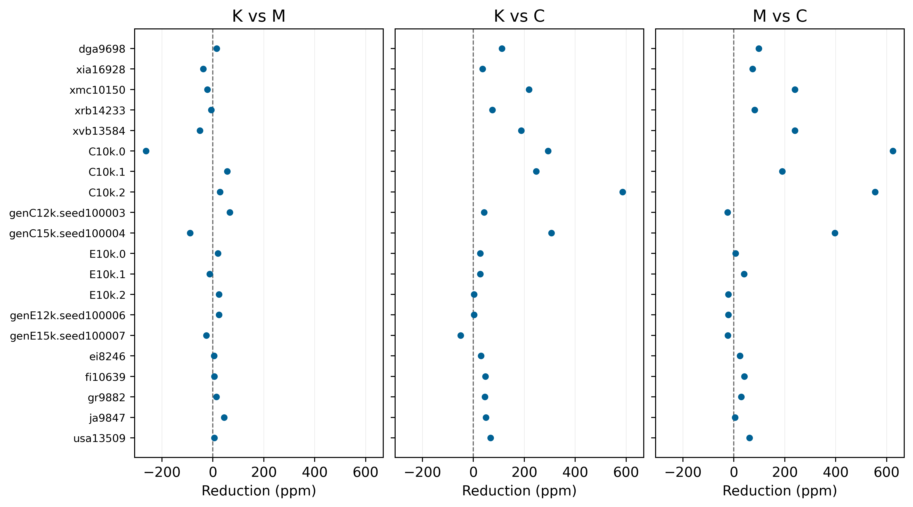
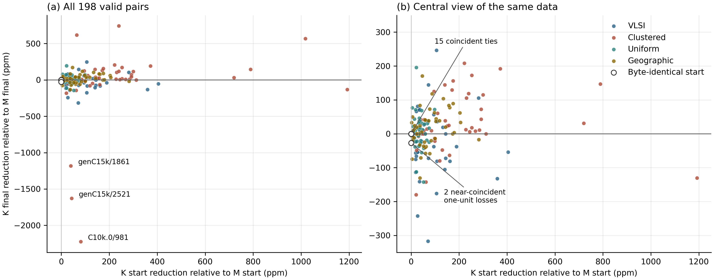

# 旅行商问题固定预算 LKH 搜索中的额外外部 GPX2 重组评估

作者与单位待确认

## 摘要

本文检验固定总时间预算下，额外三次两两广义分区交叉（GPX2）能否缩短对称欧氏旅行商问题的最终交付路线。基准 C 以共同的 LKH 派生配置从坐标开始搜索。M 由三条父环中最短者续搜。K 在同一父池上执行三次外部 GPX2，从合格父环及子环中择优续搜。两臂分别全额承担共同父池费用，K 额外承担重组与核验开销。当前主批次覆盖 20 张图，每图 10 个种子，单项总预算 90 秒。600 项均取得终态，596 条路线通过独立验环计长。K 对 M 的 198 个有效配对中，97 短、28 平、73 长。地图等权平均缩短为 −9.98 ppm，95% 地图重抽样区间为 [−43.47, +15.36] ppm，双侧 p = 0.648。K 对 C 与 M 对 C 的等权平均缩短分别为 +117.59 和 +130.64 ppm，原定 Holm 校正 p 值分别为 0.000252 和 0.001682。V22 与 R4 分批报告。当前证据尚不能确定额外重组在所测条件下具有稳定的平均净收益。

**关键词** 旅行商问题，Lin–Kernighan–Helsgaun，分区交叉，固定预算，配对比较

## 1. 引言

对称旅行商问题要求给定城市各访问一次并回到起点，最小化完整环长度。LKH 使用候选集与可变深度交换搜索，在大规模 TSP 上具有影响力 [1]。增加初始路线或重组操作可能改善启发式的起点，但也会占用后续搜索和交付时间。因此，仅比较重组后的中间解，不能说明其在固定总预算下的实际价值。

当前主批次有一个登记的主要问题。在相同父池和总预算下，额外三对外部 GPX2 相对最短父环续搜是否带来最终路线净收益？20 图、600 项是主要证据，C_ref 提供共同配置下的基准。V22、R4 及历史条件诊断用于解释背景，按各自协议单列。

本文的工作是记录实际共享的父池和两臂独立计费，按图比较有效交付，同时保留未交付与资源失效。历史起点和终点记录量化了不同路线起点优势在续搜中的保留与反转。

## 2. 相关工作

Helsgaun 的 LKH 将候选边与交换搜索结合 [1]。LKH-2 扩展了 k-opt 子动作 [2]，LKH-3 技术报告描述了后续求解器 [3]。Tinós、Helsgaun 和 Whitley [4，第 4–5 节] 在预设试探次数和运行次数的多试探 LKH 中比较 GPX2 与 IPT，并指出较好的重组后代不一定改善迭代局部搜索的最终表现。随后也有跨独立运行的 GPX2 研究 [5]，Hains 等讨论了聚簇实例上的交叉 [6]。本文以相同三父路线和同一总墙钟预算为条件，两臂分别全额计入父池费用，量化额外三次 GPX2 对最终交付路线的净差异。

固定预算下以多个短运行选择后续对象，与 bet-and-run 思路有直接联系。Friedrich 等提出通用 bet-and-run 策略并包含旅行商局部搜索案例 [7]；Weise 等研究使用性能轨迹预测后续运行，并将决策成本纳入时间预算 [8]。本文 M 是针对本研究共同 LKH 配置和三个父环的一种实证比较策略。其基本思路与已有 bet-and-run 工作相关。Zhang 与 Looks 已利用多条局部最优路线的 backbone 信息偏置 LK 搜索和扰动 [9]，Taillard 与 Helsgaun 将 POPMUSIC 和路线信息用于 LKH 候选生成 [10]。因此，对基于父环的信息反馈或候选访问次序的一般原创性表述应有所限定。

已有研究比较了不同结构实例上的多种 TSP 启发式，包括使用边组装交叉的 EAX [11, 12]。后续 GPX3 文献讨论了分区交叉实现 [13]。

算法基准研究区分固定经费下的质量与达到固定目标的时间 [14, 15, 16]。本文以统一的墙钟预算比较按期认证交付的路线。

## 3. 问题、方法及开销

对于二维坐标 \(p_i=(x_i,y_i)\)，EUC_2D 边长为 \(d(i,j)=\lfloor\sqrt{(x_i-x_j)^2+(y_i-y_j)^2}+0.5\rfloor\)，沿用 TSPLIB 定义 [17]。完整路线遍历全部城市各一次并回到起点，长度为环上各边之和。独立核验检查城市覆盖和计长。

当前三臂共用同一个冻结的 Windows 求解程序，基于原作者发布的 LKH 3.0.14 修改。共同参数包括 POPMUSIC、每节点至多五条候选边、关闭次梯度上升，MOVE_TYPE 和 SUBSEQUENT_MOVE_TYPE 均为 5，MAX_TRIALS = 100000，RUNS = 1，POPULATION_SIZE = 0，SCALE = 1，PRECISION = 100。C_ref 是本研究在该配置下的对照。旧版 P5 及旧批次作者 LKH 各有独立版本记录。

- **C_ref（C）** 以组种子 \(s\) 从坐标开始连续搜索，未指定起始环。
- **M_new（M）** 从核验通过的三条父环中选择最短者，经 INITIAL_TOUR_FILE 载入同一冻结求解器，以 \(s+3000\) 续搜。
- **K_new（K）** 对同一父池的 P1/P2、P1/P3、P2/P3 做三次外部 GPX2，独立核验子环，再从合格父环与子环中择优，以 \(s+3000\) 续搜。同长时保留候选顺序中的第一条，父环排在子环之前。

三父种子为 \(s\)、\(s+1000\) 和 \(s+2000\)。每个图与种子只实际生成一次父池，M 和 K 均计入其完整的生成、认证与封存费用。K 同时承担外部重组、准备、核验和选优费用。总预算相同，两臂可用于续搜的时间可以不同。实际首工作环与传入起始环进行核对。

RECOMBINATION = GPX2 在共同二进制中选择内部合并函数。RUNS = 1 与 POPULATION_SIZE = 0 使跨轮次合并及种群路径不生效，但试探函数在局部搜索步骤后可按时限和路线状态条件尝试内部合并。Trace level 1 未逐次记录这些调用。C、父环生成和续搜都使用这一内部配置，K 的三次外部桥接发生在续搜之前。共同配置、源码条件和计时分别见补充表 S2、S3。

## 4. 实验材料与设计

### 4.1 当前 600 项主批次

主批次的 20 图覆盖 VLSI、聚簇、均匀和地理四层，每层五图。DIMACS 两层分别引用原挑战的生成器、数据与实验文献 [18, 19]，另列项目扩展图的生成种子。VLSI 和 National 数据引用 Waterloo 源站 [20, 21]，有一张地理图源于 TSPLIB [17]。各图采用同一组 10 个预登记种子，共形成 200 个图与种子组合。C、M、K 各 200 项。M/K 相邻运行，每图各有五组先运行 M 或 K。Windows 原生环境下单核串行，求解绑 CPU0，CPU1 独立监控。每进程提交内存上限 4 GiB，准入时可用物理内存至少 12 GiB，运行期下限 8 GiB。EAX 200 项与机制诊断 800 项保留原计划并暂缓，未进入当前质量分析。

**表 1　600 项主批次的实验环境。**

| 项目 | 记录值 |
| --- | --- |
| 处理器 | Intel Core Ultra 9 275HX，24 核、24 个逻辑处理器，取自 2026 年 11 月 16 日同机清单。 |
| 物理内存 | 清单记录安装 48 GiB。596 份有效回执均记录 Windows 可见 50,870,607,872 字节，即 47.377 GiB。 |
| 操作系统 | 原生 Windows 11，构建 10.0.26300，取自 11 月 20 日构建回执。 |
| 编译器和目标 | w64devkit GCC 16.2.0，x86_64-w64-mingw32。 |
| 主要编译和链接选项 | 共同求解器采用 `-O3 -std=gnu99 -fcommon -DTWO_LEVEL_TREE -march=native -ffp-contract=off`，强制包含 Windows 平台约束头，链接 `-lm`。外部桥的两个重编单元增加 `-ffunction-sections` 和 `-fdata-sections`，链接使用 `-Wl,--gc-sections -lm`。 |
| 逻辑处理器亲和性 | 求解 Job 单路串行，绑定逻辑 CPU 0，掩码为 1。监控使用逻辑 CPU 1。 |
| 供电和运行状态 | 596 份有效回执都记录准入时 AC 接电。运行期间持续供电状态、电源计划、性能模式和实际频率均未记录。 |

每臂总计费窗口 90 秒，85 秒安排停搜请求，86 秒前取得停搜证据，88 秒前认证交付，90 秒前完成清理。每条父环的相应时点为 17、18、19、20 秒。输入、候选、父池、分支处理、求解、核验交付及清理均按相应方法实际计费。正式派发前的准入等待单列。实验结束后的独立验环只用于核对已交付证据。

原导出 selection_s 记录的是最后一个外部子环核验完成的累计计费时刻，包含共同前段，派生字段改名为 last_external_gpx_verified_charged_s。它不能作为 GPX2 算子净时长或单独的选优成本。提交、停止、清理与候选发现属于不同时间事件，原记录未观察到的内部发现时间保持缺失。

### 4.2 V22 与 R4 历史批次

V22 在原生 Windows CPU2 上运行，覆盖 20 图、每图 5 个种子，得到 300 项有效 C/M/K 结果。R4 在原生 Windows 本机上覆盖 12 图、每图 3 个种子，五种方法共 180 项，164 条有效路线。其六张万城合成图含均匀、聚簇和混合各两张，另六张小图来自 Stirling 数据集 [22]。R4 同池内 M 固定先运行，暴露组和计时字段按自己的协议分析。V22 与 R4 的实验版本、机器或样本有别，统计单列。

### 4.3 30 秒历史条件诊断

旧开发图的 72 项条件诊断使用 6 张已暴露地图，每图两个父池，每池三个续搜种子，对两个既有起点各运行一次。诊断窗口包含续搜输入读取与交付，父池已提前生成并免费复用。该诊断只提供历史机制背景。

## 5. 分析方法

对同图同种子、双方均有合法交付的前者 A 与对照 B，定义改善为 \(10^6[L(B)-L(A)]/L(B)\) ppm，正值表示 A 更短。先平均图内配对，再对有配对的地图等权。交付率、资源异常和执行错误单列，缺失路线不赋分。

主批次唯一主要比较为 K/M，沿用图级双侧符号翻转检验和 100,000 次地图百分位重抽样区间，随机种子 20261120。检验假定零假设下地图级效应符号可独立翻转 [23]。重抽样以整图为单位 [24]。固定选图限制了外推。原四项次要 Holm 家族 [25] 保留 K/C、M/C、K/EAX、M/EAX 两个已观察和两个未观察比较。后两项以 1 占位参与校正，并无路线结果。四层地图、留一图和 196 组三法均有效的共同配对仅用于描述性敏感性分析。R4 的五项比较族、20,000 次重抽样和 V22 的协议仍单列。

## 6. 结果

### 6.1 当前 600 项主批次

C、M、K 分别交付 198、199、199 条有效路线，596 条路线全部独立验环计长。四项异常分别为 C 的磁盘中断，K 和 C 的运行中分页保护，以及 M 在原生求解前触发启动内存门槛。同组 K 的有效结果保留，在有合法配对的比较中正常计入。预算正常耗尽且未交付的项目为零。

**表 2　当前有效配对主结果。** 三项均覆盖 20 张地图。区间为图级百分位重抽样，次要比较报告原 Holm 家族的校正 p 值。

| 前者/对照 | 有效配对 | 短 / 平 / 长 | 地图等权改善（ppm） | 95% 区间（ppm） | p 值 |
| --- | ---: | --- | ---: | --- | ---: |
| K/M | 198 | 97 / 28 / 73 | −9.98 | [−43.47, +15.36] | 0.648 |
| K/C | 197 | 105 / 6 / 86 | +117.59 | [+59.78, +186.98] | 0.000252 |
| M/C | 197 | 105 / 3 / 89 | +130.64 | [+56.19, +218.04] | 0.001682 |
| K/EAX | — | — | 未估计 | — | — |
| M/EAX | — | — | 未估计 | — | — |

{width=94%}

K/M 的地图中位效应为 +5.76 ppm，12 图为正、8 图为负。C10k.0 在九个可用配对中的地图平均为 −263.07 ppm，是最负的一图。留一图的总体均值为 −14.02 至 +3.34 ppm，主结果保留全部 20 图。描述性分层的 K/M 均值为 VLSI −20.47、聚簇 −40.30、均匀 +5.98、地理 +14.88 ppm，每层五图。该分层不能单独识别由结构造成的差异。三种方法都有效的 196 个组合另列在补充材料，原主分析继续使用各比较的有效配对。

200 个父池的共同计费均值为 51.394 秒。198 个 M/K 均有效的配对中，M 和 K 启动续搜进程的平均累计时点分别为 52.803 和 53.066 秒，配对差为 0.262 秒，其中含实际分支准备、核验和系统开销。200 个 K 臂的三个外部进程从启动到观测 Job 成员全部退出的区间，每臂合计平均 0.131 秒。该记录包含进程开销，单凭它无法解释路线质量差异。

两臂按完整记录分别计费。三个父运行约 17 秒的搜索请求和约 51 秒共同前段来自登记设计。本批没有比较不同预算或该比例的最优性。补充表 S3 给出计费事件；补充图 S1 给出有效配对的经验分布。20 图效应见图 2。

**表 3　四层地图等权效应（ppm，描述性）。**

| 地图层 | 图 | K/M | K/C | M/C |
| --- | ---: | ---: | ---: | ---: |
| VLSI 工程 | 5 | −20.47 | +125.80 | +146.27 |
| DIMACS 聚簇 | 5 | −40.30 | +294.94 | +348.27 |
| DIMACS 均匀 | 5 | +5.98 | +1.77 | −4.21 |
| 地理 | 5 | +14.88 | +47.83 | +32.21 |

{width=94%}

### 6.2 审阅起点与最终路线

对 198 个有效配对使用未舍入整数路线长度，起点和终点分别以 M 对应长度作分母。各臂续搜改善以自身起点为分母。表 4 区分配对等权与地图等权。两个父池不能形成有效配对，其中 M 有一次准入内存不足，K 有一次触发运行中分页保护。

**表 4　当前 198 对的起点和终点收益（ppm，事后描述）。**

| 配对子集 | N | 起点均值/中位 | 终点配对均值/中位 | 终点地图等权 | 短/平/长 | M/K 续搜均值 |
| --- | ---: | ---: | ---: | ---: | ---: | ---: |
| 全部 | 198 | +95.91 / +47.68 | -8.77 / +0.00 | -9.98 | 97/28/73 | 272.63/168.03 |
| K 起点短 | 181 | +104.92 / +55.44 | -9.30 / +9.06 | -9.94 | 97/13/71 | 281.63/167.50 |
| 同起点字节 | 17 | +0.00 / +0.00 | -3.17 / +0.00 | -2.45 | 0/15/2 | 176.76/173.59 |

K 在 181/198 对中起点更短（91.41%）。其中 71/181 对最终更长（39.23%）。17 个选定文件字节相同的配对中，15 对终点同长，xvb13584 的种子 1861 和 2521 各有一例 K 长 1 个单位。原始起点、实际首环、续搜种子和版本均已核验。不能仅凭这两例认定约 0.262 秒的累计计费启动差造成了终点差异。三个大幅负例来自两张图，完整权重下对原地图等权结果的贡献按顺序为 −12.35, −8.14, −5.92 ppm，全部保留。费用分解与负例见补充表 S5、S6。

{width=94%}

### 6.3 执行顺序敏感性

原 5/5 分配和 600 条实际派发已对照。有效配对中 K 先跑与 M 先跑各 99 对，地图等权效应分别为 +15.47 与 -32.15 ppm。20 个图内差值的均值为 +47.62 ppm，中位数 +16.99 ppm，14 图为正，地图级 95% 重抽样区间为 [5.74, 111.32] ppm。地图级双侧精确符号翻转枚举 2^20 种组合，未调整 p=0.03557。依赖条件可交换与无干扰的另一项地图内标签置换敏感性得到 p≈0.200。两项均是事后探索。图内对两种顺序各给 1/2 权重得 −8.34 ppm，原预登记主估计仍为 −9.98 ppm。正式日志未连续记录温度、有效频率和总试探数，不能从执行顺序关联认定热节流，也不能推定它解释了旧 R4。

{width=94%}

### 6.4 历史探索批次

V22 与 R4 的基准、软件和运行条件各自独立。V22 的 K/M 平均效应为正，R4 小幅偏负。R4 的两种作者 LKH 对照与部分 EAX 覆盖另报。V22 与 R4 的交付、比较、失败、设置及历史图见英文历史附录表 H1–H9（包括交付状态 H3）和图 H1–H3 [26]。72 项早期条件续搜使用已有父池且只计续搜窗口，单独报告。

### 6.5 独立补验

EAX 独立补验已派发 200/200 项，终态 200 项，有效 199 项。条件续搜已派发 120/120 项，终态 120 项，有效 120 项。两批均另列。EAX 在另一时段按相同总时限计费。30 秒诊断复用两张图的三个既有父池和真实起点，每个池 20 个新续搜种子，不重复计父池生成。本轮补验不改写原登记 600 项统计。 e0316 的首试证据失败仍不计分。原事后审计把准备时间戳用于 85 秒阈值判断。对后续未派发槽位单独冻结审计修订，以记录的自有 Job 终止调用时刻判断；原生求解、费用和时限不变。M/EAX 共 198 对，159/2/37 短/平/长，地图等权均值 +24030.25 ppm，95% 百分位区间 [+6763.64, +50836.32]。K/EAX 共 198 对，164/3/31 短/平/长，地图等权均值 +24008.70 ppm，95% 百分位区间 [+6742.41, +50802.43]。另列的 EAX 报告包含交付、缺失配对和多重比较。 C10k.0/981 的 20 个有效种子对为 14/0/6 短/平/长，均值 +716.29 ppm，条件种子重抽样区间 [+251.78, +1200.80] ppm。genC15k.seed100004/2521 的 20 个有效种子对为 12/0/8 短/平/长，均值 -109.03 ppm，条件种子重抽样区间 [-371.59, +139.14] ppm。genC15k.seed100004/1861 的 20 个有效种子对为 8/0/12 短/平/长，均值 -219.79 ppm，条件种子重抽样区间 [-664.72, +273.42] ppm。

## 7. 讨论

当前 K 对 M 的短例多于长例，但少数图的负差幅度较大，使地图等权点估计略偏向 M。区间跨零，额外三次外部重组带来的平均净收益仍不确定。相对共同配置的 C，K 与 M 在各自有效配对中均有较短的地图等权平均路线，两项次要比较经原 Holm 校正后仍获得支持。两臂之间的结论来自直接的 K/M 配对。

V22 的 K/M 平均值为正，R4 与当前点估计略负。图集、执行器、预算核对与软硬件条件各有差异，跨批方向不能归因于单个因素。R4 记录的起点和终点差异与既有 GPX2 研究提出的问题一致，提供历史描述性证据。当前批内多数 K 起点更短，但部分优势在续搜后逆转。计时与执行顺序是实测关系，尚不能分别识别重组准备、起始环、搜索轨迹及系统状态的作用。固定起点条件补验也不改变原 90 秒总预算结果。

## 8. 结论

在登记的 90 秒、20 图及统一 LKH 配置下，额外三对外部 GPX2 相对同父池 M 的平均路线收益尚不确定。K 和 M 相对 C 的有效配对平均路线均缩短。记录完整计费、交付和失败，能区分两臂的路线影响与运行可用性。

本批未运行 EAX。R4 的两种作者 LKH 及部分 EAX 只提供分列的历史对照。地图为固定样本，运行顺序、算法配置及时间窗均限制解释，结论也不等同于全局最优或方法等效。

## 数据、软件和声明

随包提供当前数字账本、参数与版本索引、CSV 独立复算和绘图入口、路线哈希及计长核验资料。复核既有路线需要取得匹配坐标与经授权的城市顺序文件。从坐标重新定时求解还需要依法取得冻结求解器、衍生修改和符合原资源规则的 Windows 环境。审稿访问和取得条件见证据附录。V22、R4 的原始数字和历史复算仍可从[历史仓库](https://github.com/wang-d-c/TSP-SCI-Reproducibility-And-Evidence-20261118)查询。

作者、单位、通讯方式、基金、利益冲突和终稿同意待作者核实。

## AI 辅助声明

ChatGPT 和 Codex 辅助了研究设计、代码开发、分析和稿件准备。作者投稿前按目标期刊要求确认披露范围、位置与措辞，并对提交内容和证据负责。

## 参考文献

1. Helsgaun K. An effective implementation of the Lin–Kernighan traveling salesman heuristic. *European Journal of Operational Research*. 2000;126(1):106–130. https://doi.org/10.1016/S0377-2217(99)00284-2
2. Helsgaun K. General k-opt submoves for the Lin–Kernighan TSP heuristic. *Mathematical Programming Computation*. 2009;1:119–163. https://doi.org/10.1007/s12532-009-0004-6
3. Helsgaun K. An extension of the Lin–Kernighan–Helsgaun TSP solver for constrained traveling salesman and vehicle routing problems. Technical report. Roskilde University; 2017. https://forskning.ruc.dk/da/publications/an-extension-of-the-lin-kernighan-helsgaun-tsp-solver-for-constra/
4. Tinós R, Helsgaun K, Whitley D. Efficient Recombination in the Lin–Kernighan–Helsgaun Traveling Salesman Heuristic. *PPSN*, 2018:95–107. https://doi.org/10.1007/978-3-319-99253-2_8
5. Tinós R, Whitley D, Ochoa G. A New Generalized Partition Crossover for the Traveling Salesman Problem: Tunneling Between Local Optima. *Evolutionary Computation*. 2020;28(2):255–288. https://doi.org/10.1162/evco_a_00254
6. Hains D, Whitley D, Howe A. Improving Lin-Kernighan-Helsgaun with Crossover on Clustered Instances of the TSP. *PPSN*, 2012:388–397. https://doi.org/10.1007/978-3-642-32964-7_39
7. Friedrich T, Kötzing T, Wagner M. A Generic Bet-and-Run Strategy for Speeding Up Stochastic Local Search. *AAAI*, 2017. https://doi.org/10.1609/aaai.v31i1.10645
8. Weise T, Wu Z, Wagner M. An Improved Generic Bet-and-Run Strategy with Performance Prediction for Stochastic Local Search. *AAAI*, 2019. https://doi.org/10.1609/aaai.v33i01.33012395
9. Zhang W, Looks M. A Novel Local Search Algorithm for the Traveling Salesman Problem that Exploits Backbones. *IJCAI*, 2005:343–349. https://ijcai.org/proceedings/2005/182
10. Taillard É, Helsgaun K. POPMUSIC for the Travelling Salesman Problem. *European Journal of Operational Research*. 2019. https://doi.org/10.1016/j.ejor.2018.06.039
11. McMenemy P, Veerapen N, Adair J, Ochoa G. Rigorous Performance Analysis of State-of-the-Art TSP Heuristic Solvers. *EvoCOP*, 2019, LNCS 11452:99–114. https://doi.org/10.1007/978-3-030-16711-0_7
12. Nagata Y, Kobayashi S. A Powerful Genetic Algorithm Using Edge Assembly Crossover for the Traveling Salesman Problem. *INFORMS Journal on Computing*, 2013, 25(2):346–363. https://doi.org/10.1287/ijoc.1120.0506
13. de Carvalho OQ, Whitley D. Dramatically Faster Partition Crossover for the Traveling Salesman Problem. *GECCO*, 2025:818–826. https://doi.org/10.1145/3712256.3726465
14. Applegate, D. L., Bixby, R. E., Chvátal, V., & Cook, W. J. (2006). *The Traveling Salesman Problem: A Computational Study*. Princeton University Press. https://www.math.uwaterloo.ca/tsp/book/index.html
15. Bartz-Beielstein, T., Doerr, C., van den Berg, D., et al. (2020). *Benchmarking in optimization: Best practice and open issues*. arXiv:2007.03488. https://arxiv.org/abs/2007.03488
16. Hansen, N., Auger, A., Brockhoff, D., Tušar, D., & Tušar, T. (2016). *COCO: Performance assessment*. arXiv:1605.03560. https://arxiv.org/abs/1605.03560
17. Reinelt G. TSPLIB—A traveling salesman problem library. *ORSA Journal on Computing*. 1991;3(4):376–384. https://doi.org/10.1287/ijoc.3.4.376
18. Johnson, D. S., & McGeoch, L. A. (2002). Experimental analysis of heuristics for the STSP. In G. Gutin & A. P. Punnen (Eds.), *The Traveling Salesman Problem and Its Variations* (pp. 369–443). Kluwer. Springer digital record, 2007. https://doi.org/10.1007/0-306-48213-4_9
19. DIMACS. (2001). *8th DIMACS Implementation Challenge: The Traveling Salesman Problem*. Instance and generator archive. https://archive.dimacs.rutgers.edu/Challenges/TSP/download.html
20. University of Waterloo. *VLSI Data Sets*. Solving TSPs benchmark archive. https://math.uwaterloo.ca/tsp/vlsi/index.html
21. University of Waterloo. *National Traveling Salesman Problems*. Solving TSPs benchmark archive. https://www.math.uwaterloo.ca/tsp/world/countries.html
22. McMenemy P, Veerapen N, Adair J, Ochoa G. Rigorous Performance Analysis of State-of-the-art TSP Heuristic Solvers [dataset]. University of Stirling, 2019. https://datastorre.stir.ac.uk/handle/11667/127 （共享的 14 张实例依该条目的 CC BY 4.0 条款署名发布）。
23. Hemerik, J., & Goeman, J. (2018). Exact testing with random permutations. *TEST*, 27, 811–825. https://doi.org/10.1007/s11749-017-0571-1
24. Efron, B., & Tibshirani, R. J. (1993). *An Introduction to the Bootstrap*. Chapman & Hall. https://doi.org/10.1201/9780429246593
25. Holm, S. (1979). A simple sequentially rejective multiple test procedure. *Scandinavian Journal of Statistics*, 6(2), 65–70. https://www.jstor.org/stable/4615733
26. Kerschke P, Kotthoff L, Bossek J, Hoos HH, Trautmann H. Leveraging TSP solver complementarity through machine learning. *Evolutionary Computation*. 2018;26(4):597–620. https://doi.org/10.1162/evco_a_00215
