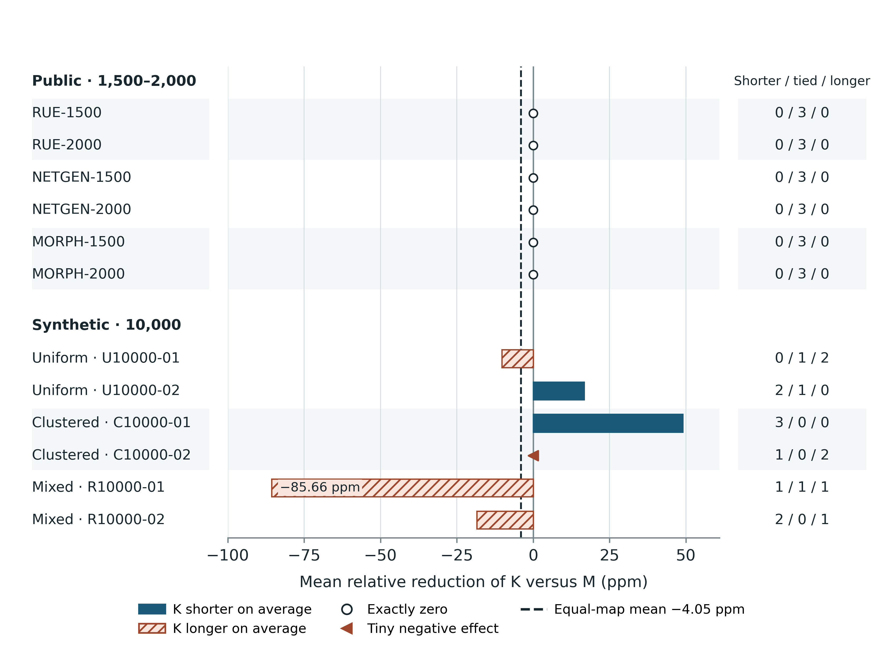
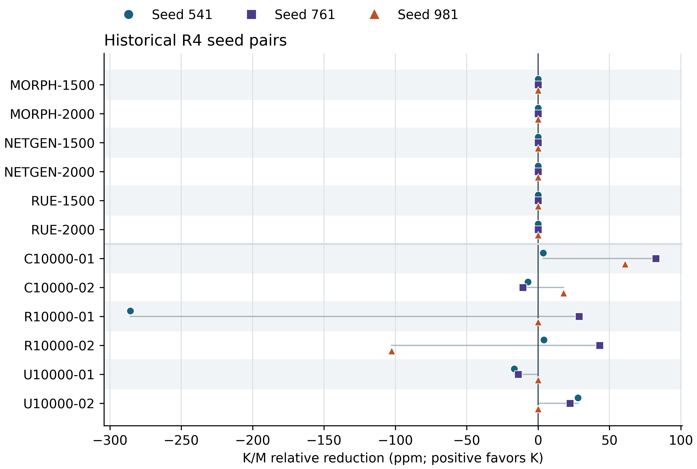

# Historical Appendix for the R4 Comparison

These tables and figures document the earlier R4 study. The 600-run primary analysis and its Supplement use separate numbering. Historical Tables H1–H9 and Figures H1–H3 are indexed in this appendix.

**Table H2. R4 map-level means of paired seed reductions (ppm). The V242- prefix is omitted in display labels. Values near zero retain sufficient precision to show their sign.**

| Map | K/M | K/C | M/C |
| --- | --- | --- | --- |
| C10000-01 | 49.02 | −0.00058 | −49.02 |
| C10000-02 | −0.00018 | 40.54 | 40.54 |
| MORPH-1500 | 0.00 | 0.00 | 0.00 |
| MORPH-2000 | 0.00 | 0.00 | 0.00 |
| NETGEN-1500 | 0.00 | 0.00 | 0.00 |
| NETGEN-2000 | 0.00 | 0.00 | 0.00 |
| R10000-01 | −85.66 | 155.47 | 241.13 |
| R10000-02 | −18.48 | 58.17 | 76.64 |
| RUE-1500 | 0.00 | 0.00 | 0.00 |
| RUE-2000 | 0.00 | 14.12 | 14.12 |
| U10000-01 | −10.22 | 122.59 | 132.81 |
| U10000-02 | 16.73 | 8.37 | −8.37 |

## Table H5 Methods and execution settings

| Item | Recorded specification |
|---|---|
| C | Start with the input coordinates and run the project P5 configuration. Its configured internal recombination is GPX2. |
| M | Generate and validate parents P1, P2 and P3; select the best valid parent; continue P5 from it. P5 retains internal GPX2; M does not perform K's three additional external GPX2 calls. |
| K | Use the same physical parent pool as M, recombine (P1,P2), (P1,P3) and (P2,P3), validate candidates, select among the valid parents and offspring, and continue P5. The actual pair labels in the code are AB, AC and BC. |
| Parent sharing and charging | The shared generation and required preparation are charged in full to each arm. K separately pays for its extra recombination, selection and validation. M does not wait for K's recombination. |
| Seeds | For group seed `s` in {541, 761, 981}, the parent seeds are `s`, `s+1000` and `s+2000`; M and K continue with `s+3000`. |
| Parent limit | Each parent has a nominal 17-second limit, also subject to the global stop-request deadline. |
| Representative P5 parameters | `CANDIDATE_SET_TYPE=POPMUSIC`, `POPMUSIC_SOLUTIONS=25`, `MAX_CANDIDATES=5`, `SUBGRADIENT=NO`, `MOVE_TYPE=5`, `SUBSEQUENT_MOVE_TYPE=5`, `BACKTRACKING=NO`, `PATCHING_C=0`, `PATCHING_A=1`, `RECOMBINATION=GPX2`, `POPULATION_SIZE=0`, `RUNS=1`, `MAX_TRIALS=100000`, `STOP_AT_OPTIMUM=NO`, `GAIN_CRITERION=YES`. |
| Author LKH common configuration | LKH 3.0.14 Ascent64-compatible build; `CANDIDATE_SET_TYPE=ALPHA`, `MAX_CANDIDATES=5`, `SUBGRADIENT=YES`, `ASCENT_CANDIDATES=50`, `MOVE_TYPE=5`, `PATCHING_C=3`, `PATCHING_A=2`, `RECOMBINATION=GPX2`, `RUNS=100000`, `PRECISION=100`, `STOP_AT_OPTIMUM=NO`, `GAIN_CRITERION=YES`. |
| Author LKH-GPX2 | `POPULATION_SIZE=0`; `MAX_TRIALS=DIMENSION` (10000 in the checked 10,000-city parameter file). |
| Author LKH-POP | `POPULATION_SIZE=10`, `MAX_TRIALS=10`; the registered account describes native ERXT crossover and GPX2 merging. |
| Outer budget | Windows, one search task at a time, registered CPU0 affinity; 90-second total ceiling, search stopping/closing by 86 seconds, certified delivery strictly before 88 seconds and cleanup within 90 seconds. Affinity does not establish exclusive access to a physical core. |
| Inner time-limit fields | The inspected native parameter files set `TIME_LIMIT=86400`, and author LKH also `TOTAL_TIME_LIMIT=86400`; these are subordinate to the outer deadline and do not provide an additional budget. |

P5-resume starts a fresh process, reads the selected incumbent through INITIAL_TOUR_FILE and rebuilds its POPMUSIC candidate set. The continuation build enforces the selected cycle at the first search trial and emits first-cycle and improvement snapshots. These operations are charged within the budget. The frozen M/K continuation files set an initial-tour fraction of one; the effective POPMUSIC initial-tour flag is off. Table H6 identifies the checked binaries and runner components.

Synthetic geometries. U samples integer points uniformly in the 0–9999 square. C uses 32 clusters laid out on an 8 × 4 grid, with integer offsets within 300 units of each cluster center. R distributes 2,000 cities in each of four boundary bands and 2,000 in a central region. The generators resample duplicate coordinates deterministically. V22 and R4 use separate registered seeds.

## Table H6 Selected R4 version hashes

| Component | SHA-256 | Scope |
|---|---|---|
| P5.exe, positive-coordinate binding | `d829cc485d1b6c454af3b1274a9be2ceb37b08ce946bf39b7bbfccde380962c1` | Local hashes of the C runtime and M/K positive runtime match. |
| P5-resume.exe, positive-coordinate binding | `f70cca81bb143f39f56f6935d5d207c8c527ac2ecaa6a26aaaa24a66c816c35e` | Local file matches the M/K plan. |
| native GPX2 | `61e4ba2c4123f83bdf4d4cd06f0433aa9c9aa9f63ce249a6a1cb9c4572ee336e` | R4 plan records this executable. |
| LKH 3.0.14 Ascent64-compatible executable | `bc7863ed0cb0f3417d7dc02a756609dbd6d5f3baa0b9d8983d9857fb755907f3` | Not a byte-identical unmodified author release. |
| M/K shared-prefix driver | `12b90fc15b3eb642f4e86b81c6692dced340d684291ef4658ebb44da16019a3d` | `prefix_v19_a07.py`; recorded in R4 admission. |
| M/K arm driver | `e48a0a2ace5b8107f5a3b7592bcb6e4c0125e6a4568b20be0d9b692983b62520` | `arm_v19_a07.py`; recorded in R4 admission. |
| Shared execution core | `e6221c4f199d067a904d538f03fe297eabcde646bf24eaa069d9a5030c66e31b` | `shared_core.py`; recorded in R4 admission. |

Separate negative-coordinate-compatible binaries also exist and have different hashes; their presence does not establish that every R4 run used them. The M/K static R4 binding points to the positive-coordinate runtime and requires upstream checks. Run-specific binary evidence must be used for any per-instance claim. Limited integer-range and negative-coordinate tests are not a proof of safety for all internal paths. The archived numeric source retains each hash as a single uninterrupted string.

The author LKH Ascent64 build receipt records GCC executable SHA-256 `e47ff11a48f1dd4546a0e5ae14913ea582f0c77a4c9a48ceb35ad8d2880fe27d` and compilation commands including `-O3 -std=gnu99 -fcommon -DTWO_LEVEL_TREE -march=native -ffp-contract=off`; the local toolchain record reports GCC 16.2.0. The V22 P5 build is also recorded with GCC 16.2.0 and those nominal options, but `-march=native` and machine/toolchain details prevent assuming byte-identical output on a different computer.

**Table H6a. Example parameter-file hashes.**

These hashes include the original path fields and identify the specific files, not a universal configuration. M and K use different paths, so their file hashes differ even though the checked non-path parameter fields and seed match. The actual parameter files are not redistributed here without rights review.

| Recorded example | SHA-256 |
|---|---|
| C, U10000-02 / 761 `run.par` | `e39ab2319f0fb1e21da0978ab1abc3c99bc307fa550e0f4aa39b2d2efa5393cc` |
| Third parent, U10000-02 / 981 `run.par` | `734b040f0c97f346fb20a9c4a48adcdafad4e13075f32177f8a75a18b52af786` |
| M continuation, U10000-02 / 981 `resume.par` | `4f9e21fe21aa220d4fc9bc49aa3c85134149a96e55a37c8e93824dbc2483dfc8` |
| K continuation, U10000-02 / 981 `resume.par` | `ac9915f812bf7d287c621b9e778ec664050c8cfdf43449e92720338249a337f5` |
| LKH-GPX2, C10000-01 / 541 `parameters.par` | `7a7438a669972a507f457beee784c3dd851df62131017231a4b9e8876d870848` |
| LKH-POP, C10000-01 / 541 `parameters.par` | `2346fb5d26dd1ffba11871caa7a68c631308679bfe2c7e9333bc121e5cd3cc4c` |

## Table H7 Recorded time fields in the 36 R4 M/K groups

Each field has 36 observations. Values are arithmetic means in seconds. Available continuation time is an allowance. The commit timestamp is elapsed charged time. Adding these fields would count some time twice.

In R4, the exported final_delivery_s measures the final M or K arm commit on the charged clock, including the shared prefix. For C and both author LKH settings, it measures the commit of the selected scored candidate, which may precede the observed stop. This field cannot compare discovery or stopping speed across methods. The internal discovery time may be unknown.

| Recorded field | M | K | Interpretation |
|---|---:|---:|---|
| `prefix_paid_s` | 53.09 | 53.09 | Each arm is charged for the shared prefix; these fields include required preparation and are not pure solver CPU time. |
| `pair_wall_s` | Not applicable | 0.329 | K's recorded three-pair GPX2 wall interval; range 0.218–0.507 seconds. |
| `resume_available_budget_s` | 31.15 | 30.88 | Recorded available continuation budgets, not CPU time, actual exit or discovery times. |
| `commit_paid_s` | 85.89 | 85.89 | Recorded paid certification/commit time, not the instant when the best solution was first discovered or a process exited. |
| Independent selection and validation subcosts | Unknown | Unknown | The records do not provide complete, separately timed costs that may be combined into a full component breakdown. |

The continuation allowance includes branch preparation in its elapsed charge. Across the small maps, GPX2 time had median 0.264 s (quartiles 0.236–0.276 s). On the large maps the median was 0.398 s (0.361–0.411 s). Median paired M minus K continuation allowance was 0.219 s and 0.348 s, respectively. On C10000-02 with seed 981 the charged prefix was 54.91 s in each arm. The selected-start commit took 2.22 s for M and 1.93 s for K, so the continuation allowances were 28.67 s and 28.96 s. The three GPX2 calls occupied 0.36 s inside K’s recorded work. The timing records do not identify a separate cause for every branch delay. The companion cost_distributions.csv supplies the aggregate values.

Post hoc denominator check. On each map, compute 100 × (mean reference length − mean comparison length) / mean reference length using the same paired seeds. This gives exactly zero for C10000-02 in K/M and C10000-01 in K/C. The equally weighted means are −4.05 ppm for K/M and 33.28 ppm for K/C. The registered estimator, intervals and Holm test remain primary.

## Table H8 Endpoints attaining the published optimum on the six public R4 maps

Each entry counts the runs that attained the published length among the three registered seeds. All five methods delivered a valid tour in each of these 18 R4 map–seed groups. These maps were matched after the main analysis.

|Map|Optimum|C|M|K|LKH-GPX2|LKH-POP|
|---|---|---|---|---|---|---|
|MORPH-1500|18,533,583|3/3|3/3|3/3|1/3|3/3|
|MORPH-2000|21,099,918|3/3|3/3|3/3|0/3|1/3|
|NETGEN-1500|9,149,713|3/3|3/3|3/3|3/3|3/3|
|NETGEN-2000|9,852,725|3/3|3/3|3/3|0/3|1/3|
|RUE-1500|28,369,732|3/3|3/3|3/3|3/3|3/3|
|RUE-2000|32,633,059|1/3|3/3|3/3|3/3|3/3|
|All six|—|16/18|18/18|18/18|10/18|14/18|

The coordinates, city IDs, dimension, distance type and input-file SHA-256 matched the benchmark files. Reference lengths come from the authors’ instance-specific .opt files; Kerschke et al. (2018), Section 3.3, report using Concorde. The complete reference appears below. The locally certified tour lengths were compared with these published numbers. No exact solve or verification of a Concorde proof certificate was performed here.

In V22, eight different public maps supplied 40 valid routes per arm. C attained the corresponding optimum in 37 runs, M in 36 and K in 39. These results are reported separately from R4. The 18 project-generated maps across the two batches have no matched external reference in this analysis.

The public companion tables list all 14 reference lengths and summarize 210 valid historical route comparisons by instance and method. The corresponding individual numeric outcomes appear in the public seed-level tables, with saved city orders separately available for authorized review. For a valid tour of length L and published optimum O, the percentage gap is 100 × (L − O) / O. A zero gap says nothing about when the optimum was first found.

## Table H9 Registered R4 map-level sign-flip tests

| Comparison | Nonzero maps | Raw p | Holm p |
| --- | --- | --- | --- |
| K/M | 6 | 0.65625 | 1.0 |
| K/C | 7 | 0.03125 | 0.125 |
| K/LKH-GPX2 | 7 | 0.015625 | 0.078125 |
| K/LKH-POP | 6 | 0.03125 | 0.125 |
| K/EAX | — | Not estimable | Not estimable |

## Historical figures

{width=86%}

{width=86%}

{width=94%}

## Earlier cohorts and comparative delivery

### Historical V22

V22 produced 300 valid C/M/K results with no recorded formal failures or retries. K/C was shorter/tied/longer in 36/38/26 of the 100 seed groups and had a map-equal mean reduction of 34.76 ppm; K/M was 44/41/15 with 29.30 ppm; M/C was 27/37/36 with 5.46 ppm. The earlier V23 audit used 20,000 map-level bootstrap resamples stratified by map family and reported 95% intervals of [12.52 ppm, 58.31 ppm] and [16.49 ppm, 41.84 ppm] for K/C and K/M, respectively. In 64 groups K's recombination start was strictly shorter than the best parent; final K/M outcomes in those groups were 44 shorter, five tied and 15 longer. These are CPU2 results under that batch's protocol, not observations that can be paired or pooled with local R4.

### Historical R4 C/M/K

All C, M and K slots yielded valid routes on 12 maps and three seeds. Historical Table H1 reports the map-weighted results. K was shorter more often than it was longer relative to M, but the longer outcomes had a larger average magnitude. The K/M interval crosses zero and the observed data do not demonstrate equivalence.

**Historical Table H1. R4 complete paired route comparisons.**

| Comparison | Valid pairs / maps | Shorter / tied / longer | Map-equal mean (ppm) | Exploratory 95% interval (ppm) |
| --- | --- | --- | --- | --- |
| K/M | 36 / 12 | 9 / 21 / 6 | −4.05 | [−22.41, 10.96] |
| K/C | 36 / 12 | 13 / 16 / 7 | 33.27 | [7.45, 64.61] |
| M/C | 36 / 12 | 11 / 17 / 8 | 37.32 | [−0.18, 84.60] |

Historical Appendix Table H9 reports the four estimable registered tests and the incomplete EAX contrast. The estimable comparisons have six or seven nonzero maps, giving minimum two-sided sign-flip p-values of 0.03125 or 0.015625. Both exceed the first Holm cutoff of 0.01. The observed tie structure therefore prevented family-wise rejection at 0.05. M/C is calculated directly from its own pairs.

K/M has two positive, six zero and four negative means under the registered seed-relative metric. Its median map effect is zero. The largest individual improvement was 82.49 ppm and the largest regression was 285.75 ppm (139 length units on R10000-01/541). Leaving one map out yields means from −8.87 ppm to 3.37 ppm. The registered exposure sensitivity remains slightly negative. Both methods attained the published optimum in all 18 pairs on six 1,500–2,000-city instances (Kerschke et al., 2018). On six 10,000-city maps, K/M was 9 shorter, 3 tied and 6 longer with mean reduction −8.10 ppm. This exploratory contrast confounds size with origin and structure. On C10000-02 the three absolute K/M differences sum to zero, but seed-specific denominators give the registered map mean a tiny negative sign. The supplementary sensitivity first computes each method’s mean within each map.

Historical Appendix Figure H1 shows the K/M map reductions. Exact ties are marked separately, and the dashed line is the equal-map mean.

Historical Appendix Table H2 reports the complete R4 map values. Tables H5 and H6 in the same appendix document the R4 settings and selected version hashes. Table H8 lists attainment of published reference lengths.

### Historical R4 external baselines and delivery

**Historical Table H3. R4 terminal status.**

| Method | Valid | Budget non-delivery | Resource-monitor interruption |
|---|---:|---:|---:|
| C | 36 | 0 | 0 |
| M | 36 | 0 | 0 |
| K | 36 | 0 | 0 |
| Author LKH-GPX2 | 29 | 7 | 0 |
| Author LKH-POP | 27 | 8 | 1 |

All 180 R4 slots for these five methods reached a terminal state, with 164 valid routes. Both author-LKH configurations delivered in zero of six runs on the two 10,000-city clustered maps. The twelve logs report completed ascent and 72.97–74.58 CPU s of preprocessing. These CPU times describe the burden of initial work. They do not locate the wall-clock cutoffs. This comparison uses the registered ALPHA/subgradient configurations and provides no controlled comparison with an author LKH POPMUSIC/no-subgradient configuration.

**Historical Table H4. R4 comparisons with valid deliveries.** The two K-versus-author-LKH contrasts belong to the five registered R4 tests. The other four rows are descriptive.

| Comparison | Role | Valid pairs / maps | Shorter / tied / longer | Map-equal mean (ppm) | Exploratory 95% interval (ppm) |
| --- | --- | --- | --- | --- | --- |
| K/LKH-GPX2 | Registered | 29 / 10 | 17 / 10 / 2 | 242.25 | [65.63, 516.40] |
| K/LKH-POP | Registered | 27 / 10 | 13 / 14 / 0 | 316.30 | [76.88, 639.88] |
| M/LKH-GPX2 | Descriptive | 29 / 10 | 17 / 10 / 2 | 247.80 | [64.60, 538.95] |
| M/LKH-POP | Descriptive | 27 / 10 | 13 / 14 / 0 | 312.13 | [75.81, 632.85] |
| C/LKH-GPX2 | Descriptive | 29 / 10 | 16 / 8 / 5 | 204.21 | [42.25, 450.16] |
| C/LKH-POP | Descriptive | 27 / 10 | 13 / 12 / 2 | 259.30 | [68.96, 509.60] |

The first two rows were among the five registered R4 contrasts. The four descriptive rows use the same valid-pair rule. Historical Appendix Table H9 gives the registered p-values.

The original R4 EAX arm used an adapted implementation of edge-assembly crossover (Nagata & Kobayashi, 2013). It delivered 18 of 19 attempts on six large maps, with 17 slots deferred. Among the available pairs, M/EAX, C/EAX and K/EAX were shorter, tied or longer in 18/0/0, 16/0/2 and 17/0/1 cases. The separately versioned EAX supplement delivered 18, failed on one and left 17 unstarted. These partial records describe availability and observed valid pairs.

### Historical starting tours and continuation

M and K parent hashes match in all 36 R4 groups. In 16 groups the selected starting cycles are identical up to rotation and reversal, and their final lengths tie. In the remaining 20 groups K starts shorter; it finishes shorter in 9, tied in 5 and longer in 6. On four of the small-map runs, K started at the published optimum while M reached it during continuation. Of the 16 strictly better K starts on the 10,000-city maps, 9 led to shorter endpoints, 1 to a tie and 6 to longer endpoints. No matched external optimum was established for these six large maps. Thus a shorter start did not guarantee the shorter final tour in these observed configurations. The per-group start and final differences are shown in Historical Appendix Figure H2; their association is descriptive and does not isolate a causal mechanism. It is not possible from this observation alone to attribute the six reversals uniquely to extra recombination time, route structure, initialization state, randomness or other search dynamics. Historical Appendix Figure H3 shows the distribution of all 36 endpoint seed pairs within maps.

The three external GPX2 calls took 0.33 s on average. Available continuation allowances averaged 31.15 s for M and 30.88 s for K. On the larger maps the paired allowance difference (M minus K) ranged from −0.288 to +0.450 s. The allowance is computed after charged branch preparation. A longer measured M startup explains the most negative difference (Historical Appendix Table H7).

A separate 30-second diagnostic used 12 already-exposed development pools from six maps and three continuation seeds per pool (72 valid tasks). Start A was the shortest parent and start B was the tour selected by the historical K procedure. B finished shorter/tied/longer in 12/20/4 of 36 pairs. The 18 same-cycle pairs tied. Among the 18 pairs starting from different cycles, B started shorter and finished shorter/tied/longer in 12/2/4. A ran before B and the already-generated pools were supplied without charge. These repeat seeds characterize sensitivity in the development pools. R4 used different pools and one continuation seed per pool.

## Historical references

Kerschke, P., Kotthoff, L., Bossek, J., Hoos, H. H., & Trautmann, H. (2018). Leveraging TSP solver complementarity through machine learning. *Evolutionary Computation*, 26(4), 597–620. https://doi.org/10.1162/evco_a_00215

Nagata, Y., & Kobayashi, S. (2013). A powerful genetic algorithm using edge assembly crossover for the traveling salesman problem. *INFORMS Journal on Computing*, 25(2), 346–363. https://doi.org/10.1287/ijoc.1120.0506
