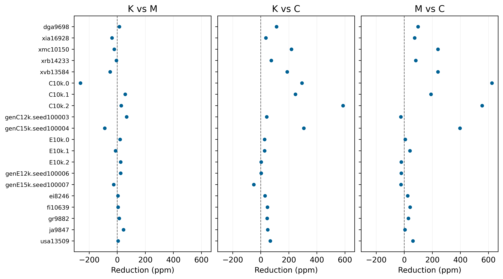
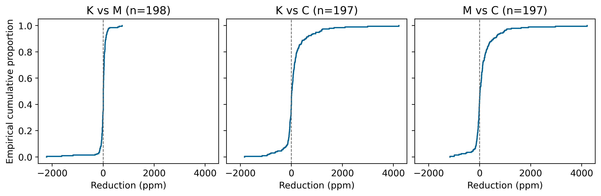

# Supplementary Methods and Statistical Checks

## S1 Recorded environment and build

**Table S1. Historical evidence for the 600-run environment.**

| Item | Recorded value |
| --- | --- |
| Host CPU | Intel Core Ultra 9 275HX, 24 cores and 24 logical processors. Same-host inventory dated 16 November 2026. |
| Physical RAM | 48 GiB installed in the host inventory. All 596 valid run receipts report 50,870,607,872 bytes (47.377 GiB) visible to Windows. |
| Operating system | Native Windows 11, build 10.0.26300, from the 20 November build receipt. |
| C compiler and target | w64devkit GCC 16.2.0, x86_64-w64-mingw32. |
| Main build flags | Common solver: `-O3 -std=gnu99 -fcommon -DTWO_LEVEL_TREE -march=native -ffp-contract=off`, forced Windows platform header, link `-lm`. The external bridge added `-ffunction-sections` and `-fdata-sections` to its two newly compiled units and linked with `-Wl,--gc-sections -lm`. |
| Logical affinity | Serial solver Job on logical CPU 0 (mask 1). Monitor on logical CPU 1. |
| Power and CPU state | All 596 valid admission receipts record AC power. Continuous supply status, active power plan, performance mode, and effective frequency during runs were not recorded. |

The same-host inventory also records the two installed modules (16 + 32 GiB). The compiler target appears in the 20 November compiler log. The original build has 175 baseline translation units. The relink receipt confirms the same flags for the replacements Ascent, AddTourCandidates and FindTour. The bridge receipt identifies its two newly compiled units as Distance.c and gpx_euc2d_io.c, alongside reused author objects. The 596 valid terminal receipts provide the run-time RAM, AC and affinity record. CPU affinity establishes logical placement. The records do not establish core type or exclusive access. The earlier hardware inventory is not evidence of the power plan or frequency during the formal run.

## S2 Common configuration and charged time

The three current arms and all parent runs share the frozen LKH 3.0.14-derived Windows build. C_ref starts without a supplied tour. The continuation arms install the selected initial tour on the first full TSP trial. Initial-tour edge insertion uses the registered normal setting. The main paper uses C, M and K as abbreviated labels.

**Table S2. Common solver configuration.**

| Component | Registered setting |
| --- | --- |
| Distance model | TSPLIB EUC_2D, SCALE 1, PRECISION 100 |
| Candidate construction | POPMUSIC, maximum candidates 5, neighbors 5, sample size 10, solutions 25, trials 1, initial-tour construction off |
| Search configuration | Subgradient off, MOVE_TYPE 5, SUBSEQUENT_MOVE_TYPE 5, BACKTRACKING off, PATCHING_A 1, PATCHING_C 0, GAIN_CRITERION on |
| Limits | RUNS 1, MAX_TRIALS 100000, STOP_AT_OPTIMUM off, POPULATION_SIZE 0, TRACE_LEVEL 1 |
| Recombinations | Conditional internal GPX2 in the common solver. The K arm adds three external bridge invocations before continuation |
| Parent and arm clocks (s) | Request, stop proof, certification, cleanup at 17/18/19/20 for parents and 85/86/88/90 for each arm |
| Placement and protection | Native Windows, serial solver CPU0, independent monitor CPU1. Commit cap 4 GiB per process. Physical memory gates at 12 GiB for admission and 8 GiB during execution |

In the frozen author archive, LKHmain.c selects MergeWithTourGPX2 according to RECOMBINATION. RUNS = 1 precludes the Run > 1 branch, and POPULATION_SIZE = 0 precludes the MaxPopulationSize > 1 branch. The linked FindTour_ablation.c still permits trial-level merge attempts after the Lin–Kernighan step while both inner time bounds permit. The best-tour case requires FirstNode->BestSuc and a non-makespan setting. The ordinal-tour case requires Dimension = DimensionSaved, Cost ≥ OrdinalTourCost, BetterCost > OrdinalTourCost and a non-makespan setting. MergeWithTourGPX2 returns early if NewDimension = 0. A merge call therefore need not reach the internal gpx routine. Trace level 1 does not provide an invocation census. K’s P1/P2, P1/P3 and P2/P3 bridge processes and their verified child tours have individual records.

The 200 recorded pools share identical paid fees between M and K. Parent tour byte identities were checked for all 600 parent files. Continuation parameter files are identical within the 199 groups with a file for each arm. The M arm in the remaining group was blocked during admission and had no continuation parameter file. It retained the fee and pool identity in its result envelope.

**Table S3. Observed timing quantities.**

| Observed event or interval | Sample | Mean seconds | Range in seconds |
| --- | ---: | ---: | ---: |
| Full sealed pool fee paid by each arm | 200 pools | 51.394 | 51.160 to 51.487 |
| Three launches to observed Job-empty intervals, summed within K | 200 K arms | 0.131 | 0.094 to 0.191 |
| Three external calls' Job CPU time, summed within K | 200 K arms | 0.040 | 0 to 0.094 |
| Last external child verified, on the charged clock | 200 K arms | 53.042 | 52.751 to 53.241 |
| K minus M continuation launch on each arm's charged clock | 198 valid M/K pairs | 0.262 | 0.155 to 0.406 |

The field selection_s is retained in the frozen export. The portable numeric ledger names its exact value last_external_gpx_verified_charged_s. It is the last recorded child verification time from the arm’s charged origin. The elapsed process interval includes launch, operating-system and observation costs. The time between continuation launches includes all measured preparation differences. None of these fields alone identifies the effect of recombination time on the final tour.

The source and timing audit, pool and fee records, and individual timing events are linked from the accompanying [methods note](方法与计时核查.md).

## S3 Descriptive statistical checks

**Table S4. Descriptive means by source stratum.**

| Source stratum | Maps | K/M ppm | K/C ppm | M/C ppm |
| --- | ---: | ---: | ---: | ---: |
| VLSI engineering | 5 | −20.47 | +125.80 | +146.27 |
| DIMACS clustered | 5 | −40.30 | +294.94 | +348.27 |
| DIMACS uniform | 5 | +5.98 | +1.77 | −4.21 |
| Waterloo geographic | 5 | +14.88 | +47.83 | +32.21 |

These strata organize the fixed maps by source and structure. The means are descriptive. No between-stratum hypothesis test was added.

The same 196 complete C/M/K groups support the following common-coverage check across all 20 maps. The four incomplete groups remain represented in the delivery ledger. The main statistical analysis continues to use the eligible pairs for each contrast.

**Table S5. Common-coverage sensitivity among 196 complete triplets.**

| Comparison | Shorter / tied / longer | Map-equal ppm | 95% map-bootstrap interval, ppm |
| --- | --- | ---: | --- |
| K/M | 97 / 26 / 73 | −9.74 | [−43.44, +15.62] |
| K/C | 105 / 6 / 85 | +121.01 | [+61.04, +192.49] |
| M/C | 104 / 3 / 89 | +130.74 | [+56.35, +218.19] |

The K/M leave-one-map range is −14.02 to +3.34 ppm. The mean becomes positive only in the check omitting C10k.0. C10k.0 contributes −263.07 ppm across nine eligible pairs and includes the most negative pair (seed 981, −2223.46 ppm). The registered result retains that instance and all its eligible pairs. The complete-group and leave-one-map results are sensitivity checks.

{width=96%}

{width=95%}

The standalone [current statistical annotations](../03_数据与复算/statistical_notes_EN.md) give the original inference family and links to machine-readable results. The separate Historical Appendix contains historical Tables H2 and H5–H9 and historical Figures H1–H3. The main English text contains historical Tables H1, H3 and H4.
